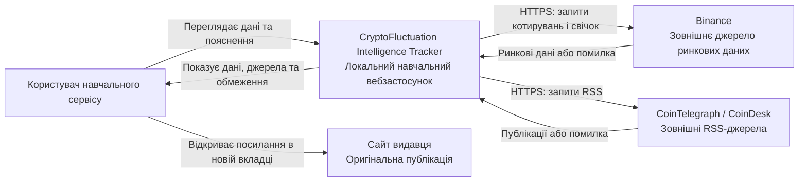
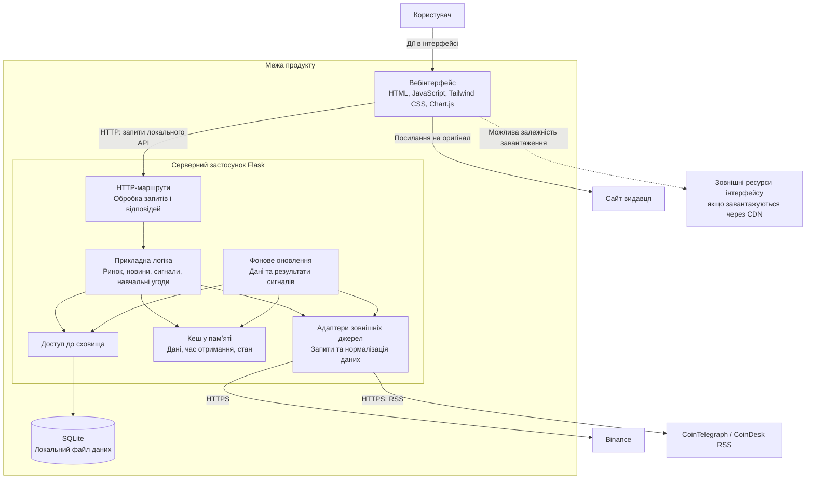

# Архітектура системи

## 1. Статус документа

Версія 0.1 — проєкт архітектури для обговорення.

Документ описує межі системи, основні частини,
зовнішні залежності та розподіл відповідальності.

За основу взято технологічний стек наявного прототипу.
Відповідність конкретних деталей реалізації цій моделі
потрібно перевірити окремо.

Схеми використовують рівні деталізації C4:
контекст системи та контейнери.
Вони подані засобами Mermaid, без спеціальної нотації C4.

## 2. Архітектурні цілі

- Забезпечити основний шлях першого MVP.
- Відокремити інтерфейс від отримання зовнішніх даних.
- Не приховувати відсутність або неактуальність інформації.
- Зберігати початкові умови сигналів незмінними.
- Відокремити навчальні угоди від реальної торгівлі.
- Забезпечити перевірку без зміни робочих даних.

Перший MVP охоплює FR-01–FR-08.
Компоненти сигналів і навчальних угод належать
до наступних розширень.

## 3. Архітектурний підхід

Запропоновано локальний клієнт-серверний застосунок
із монолітною серверною частиною Flask.

Основні частини:

1. Вебінтерфейс у браузері.
2. Серверний застосунок Flask.
3. Локальне сховище SQLite.
4. Зовнішні джерела ринкових даних і новин.

Логічні компоненти серверної частини не є
окремими мікросервісами.

Для навчального продукту з одним користувачем
не пропонуються окремі сервери повідомлень,
розподілений кластер або багатокористувацька авторизація.

## 4. Контекст системи — рівень 1

Система не керує доступністю зовнішніх джерел.

Відкриття оригінальної новини відбувається
у браузері користувача.
Наявність посилання не означає підтвердження
правдивості публікації.

Реальні торгові ордери не надсилаються.

## 5. Контейнери — рівень 2

Термін «контейнер» тут означає частину системи
в моделі C4, а не обов’язково Docker-контейнер.

Маршрути, логіка, адаптери, кеш і фонове оновлення
показані всередині одного серверного застосунку.

Схема визначає відповідальність, а не конкретний
розподіл Python-файлів.

SQLite не потребує окремого сервера бази даних.

## 6. Відповідальність частин

| Частина | Відповідальність | Пов’язані вимоги |
|---|---|---|
| Вебінтерфейс | Пошук, графіки, новини, пояснення та попередження | FR-01–FR-09, FR-17, FR-18 |
| HTTP-маршрути | Приймання запитів, передавання даних прикладній логіці, формування відповідей | FR-01–FR-18 |
| Прикладна логіка ринку | Підготовка котирувань і даних графіка | FR-01–FR-05 |
| Прикладна логіка новин | Підготовка публікацій і перевірка походження | FR-06, FR-07 |
| Контроль стану даних | Відокремлення актуальних, застарілих, демонстраційних і недоступних даних | FR-08 |
| Логіка сигналів | Пояснення, початкові записи та подальші результати | FR-09–FR-11 |
| Логіка навчальних угод | Додавання, закриття, видалення, скидання та статистика | FR-12–FR-16 |
| Адаптери | Робота з форматами й помилками зовнішніх джерел | FR-01, FR-04–FR-08 |
| Кеш | Повторне використання отриманих даних із часом і станом | FR-03, FR-08, NFR-01 |
| Доступ до SQLite | Збереження сигналів, результатів і навчальних угод | FR-10–FR-16, NFR-02 |
| Фонове оновлення | Планове отримання даних і перевірка результатів сигналів | FR-03, FR-11 |

Освітня довідка й мовні налаштування
не потребують окремого сервісу в запропонованій моделі.

## 7. Основні потоки даних

### 7.1. Перегляд ринку

1. Браузер запитує ринкові дані в локального API.
2. Сервер читає доступний стан кешу.
3. Відповідь містить котирування та інформацію
   про джерело, час і обмеження.
4. Інтерфейс оновлює значення без перезавантаження.

У видимій активній вкладці клієнт планує опитування
кожні 10 секунд.

Частота опитування браузером не гарантує,
що зовнішні дані оновлюються з такою самою частотою.

### 7.2. Перегляд графіка

1. Користувач вибирає монету та період.
2. Браузер запитує відповідні історичні дані.
3. Сервер отримує їх із придатного кешу
   або через адаптер джерела.
4. Інтерфейс показує графік або повідомлення про помилку.

Точки графіка не створюються штучно
для приховування відсутності даних.

### 7.3. Перегляд новин

1. Адаптери отримують RSS CoinTelegraph і CoinDesk.
2. Система нормалізує заголовок, видавця, URL і дати.
3. Перевіряється походження посилання.
4. Інтерфейс показує новини та обмеження перевірки.
5. Користувач відкриває оригінал у новій вкладці.

Інші посилання на сайти не означають,
що їхні новини автоматично завантажуються.

### 7.4. Сигнали та журнал

Цей потік належить до наступного розширення.

1. Логіка аналізу перевіряє придатність вхідних даних.
2. За достатніх умов формується сигнал.
3. У сховищі зберігаються його початкові умови,
   версія правил і знімок пояснень.
4. Після настання відповідних горизонтів
   фонове оновлення намагається отримати ринкові спостереження.
5. Результати записуються окремо від початкового знімка.

Початкові аргументи не переписуються новими даними.
Історичні сигнали не створюються заднім числом.

### 7.5. Навчальні угоди

Цей потік належить до наступного розширення.

1. Користувач вводить параметри позиції.
2. Сервер перевіряє значення.
3. Коректні дані записуються в SQLite.
4. Закриття позиції виконується узгоджено:
   створюється завершена угода та прибирається активна позиція.
5. Повторний запит не створює дубль.

Реальні кошти та біржові рахунки не використовуються.

## 8. Зберігання та життєвий цикл даних

### Кеш

У кеші можуть перебувати:

- поточні котирування;
- отримані свічки;
- нормалізовані новини;
- час отримання та стан доступності джерел.

Втрата кешу після перезапуску не повинна
знищувати підтверджені записи навчальних угод або сигналів.

### Постійне сховище

Для наступних розширень у SQLite передбачаються:

- початкові записи сигналів;
- результати сигналів;
- активні навчальні позиції;
- завершені навчальні угоди.

Конкретні таблиці, поля, ключі та індекси
потрібно визначити в моделі даних.

### Відокремлення операцій

- Видалення помилкової позиції не імітує завершення угоди.
- Скидання навчальних угод не очищує журнал сигналів.
- Невдала операція не повинна залишати частково змінений стан.
- Дані для автоматизованих перевірок відокремлюються від робочих.

## 9. Обробка помилок

| Ситуація | Очікувана поведінка |
|---|---|
| Binance недоступний | Повідомити про обмеження; за наявності збережених значень показати час і попередження |
| Дані графіка не отримано | Показати помилку без вигаданих точок |
| RSS недоступний | Показати повідомлення або явно позначений раніше отриманий список |
| Дата новини невідома | Не вигадувати дату |
| Недостатньо даних для сигналу | Не створювати новий сигнал |
| Горизонт результату не настав | Показати очікування |
| Ринкове спостереження відсутнє | Не підміняти результат нулем |
| Некоректне введення позиції | Відхилити запит без запису даних |
| Помилка запису в SQLite | Не повідомляти про успішне збереження |
| Недоступний ресурс інтерфейсу | Показати зрозуміле обмеження та зберегти доступні текстові дані, де це можливо |

Тайм-аути, допустимий вік кешу та політику повторних запитів
потрібно конкретизувати в описі модулів та інтеграції.

Ці параметри не слід подавати як уже перевірені,
доки їх не зіставлено з реалізацією.

## 10. Межі довіри та безпечне використання

- Зовнішні RSS і ринкові відповіді вважаються недовіреними даними.
- Текст новин має відображатися без виконання стороннього HTML.
- URL публікацій потрібно перевіряти перед використанням.
- Перевірка домену не є перевіркою правдивості новини.
- Вхідні параметри перевіряються на сервері,
  а не лише у браузері.
- SQL-запити мають використовувати параметри,
  а не складання команд із введеного тексту.
- Робоча база даних, секрети й приватні ключі
  не завантажуються в публічний репозиторій.
- Локальний режим розробки не призначений
  для відкритого доступу з інтернету.
- Відсутність авторизації допустима лише
  в межах погодженого локального використання.

Це вимоги до проєктного рішення,
а не підтвердження проходження аудиту безпеки.

## 11. Зв’язок із нефункціональними вимогами

| Вимога | Архітектурний підхід |
|---|---|
| NFR-01. Швидкодія | Відповіді локального API з кешу без зовнішнього запиту всередині вимірюваної операції |
| NFR-02. Збереження даних | Постійне сховище SQLite для підтверджених записів |
| NFR-03. Адаптивність | Відповідальність вебінтерфейсу; перевірки на ширинах 390 і 1440 пікселів |
| NFR-04. Зрозумілість | Єдині пояснення джерел, помилок та обмежень у відповідних екранах |
| NFR-05. Ізоляція перевірок | Окреме тестове сховище та контроль незмінності робочих даних |
| NFR-06. Попередження | Передавання стану даних від серверної логіки до інтерфейсу |

Наявність архітектурного підходу не доводить,
що числовий критерій вимоги виконано.
Для цього потрібна окрема перевірка.

## 12. Обмеження та компроміси

Переваги запропонованого підходу:

- простий локальний запуск;
- невелика кількість технологій;
- відсутність окремого сервера бази даних;
- можливість поступово деталізувати логічні компоненти.

Обмеження:

- залежність від одного локального середовища;
- відсутність багатокористувацького режиму;
- обмеження зовнішніх джерел і мережі;
- потреба контролювати одночасний доступ до SQLite;
- втрата кешу після перезапуску;
- можливі залежності інтерфейсу від CDN.

Масштабування для багатьох користувачів,
публічне розгортання та реальна торгівля
не входять до поточного проєкту.

## 13. Відкриті архітектурні питання

1. Які логічні компоненти вже відокремлені в прототипі?
2. Які операції використовують кеш,
   а які звертаються до джерела під час запиту?
3. Як запускається та зупиняється фонове оновлення?
4. Як запобігається дублюванню фонових задач
   під час перезапуску середовища розробки?
5. Які точні тайм-аути й правила неактуальності даних?
6. Які бібліотеки завантажуються з CDN,
   а які зберігаються локально?
7. Як організовано ізоляцію тестової бази?
8. Чи погоджує викладач використання наявного сайту
   як основи навчального прототипу?

Рішення потрібно фіксувати після фактичного розгляду,
зокрема в окремих архітектурних записах ADR.

## 14. Стан перевірки

- Контекст і основні частини описано як проєктну модель.
- Відповідність моделі наявному коду ще потрібно перевірити.
- Рев’ю іншим учасником команди ще потрібно зафіксувати.
- Досягнення показників швидкодії, надійності
  та безпеки цим документом не підтверджується.

## 15. Пов’язані документи

- [Бачення продукту](../0-product/vision.md)
- [Специфікація вимог](../1-lifecycle/srs.md)
- [Межі MVP](../1-lifecycle/mvp.md)
- [Трасування вимог](../1-lifecycle/traceability.md)
- [Сценарії використання](use-cases.md)
- [Діаграма класів](class-diagram.md)
- [Журнал змін вимог](../1-lifecycle/changes.md)
