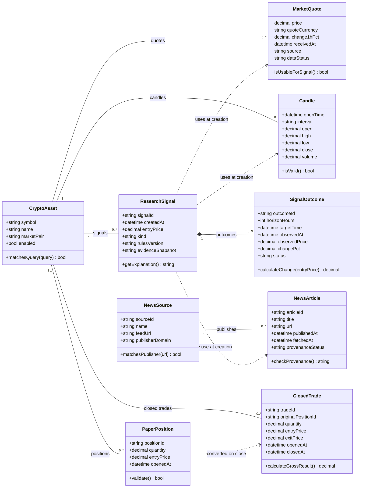

# Діаграма класів

## 1. Статус документа

Версія 0.1 — запропонована концептуальна модель.

Діаграма показує основні сутності продукту,
їхні атрибути, операції та зв’язки.

Це модель для проєктування й обговорення.
Вона не є автоматично отриманою діаграмою наявного коду.

Класи не обов’язково відповідають окремим таблицям бази даних
або Python-класам поточного прототипу.

## 2. Обсяг моделі

Перший MVP:

- CryptoAsset — криптоактив;
- MarketQuote — котирування;
- Candle — свічка графіка;
- NewsSource — джерело новин;
- NewsArticle — новинна публікація.

Наступні розширення:

- ResearchSignal — дослідницький сигнал;
- SignalOutcome — подальший результат сигналу;
- PaperPosition — навчальна позиція;
- ClosedTrade — завершена навчальна угода.

Освітня довідка й мовні налаштування
поки не деталізовані в цій моделі.

## 3. UML-діаграма класів

## 4. Призначення класів

| Клас | Відповідальність | Пов’язані вимоги |
|---|---|---|
| CryptoAsset | Позначення монети, назва, торгова пара та пошук | FR-01, FR-02 |
| MarketQuote | Ціна, годинна зміна, джерело та стан даних | FR-01, FR-03, FR-08 |
| Candle | Історичні значення для графіка | FR-04, FR-05 |
| NewsSource | Відомості про джерело та домен видавця | FR-06, FR-07 |
| NewsArticle | Заголовок, оригінальне посилання, дати та стан походження | FR-06, FR-07, FR-08 |
| ResearchSignal | Незмінні початкові умови та пояснення сигналу | FR-09, FR-10 |
| SignalOutcome | Результат зміни ціни для визначеного горизонту | FR-11 |
| PaperPosition | Активна навчальна позиція | FR-12, FR-13, FR-14 |
| ClosedTrade | Історія завершеної навчальної угоди | FR-13, FR-16 |

## 5. Пояснення зв’язків

### CryptoAsset — MarketQuote

Один криптоактив може мати багато котирувань.
Кожне котирування належить одному активу.

Зв’язок не означає, що вся історія котирувань
обов’язково зберігається в базі даних.
У першому MVP значення можуть перебувати в кеші.

### CryptoAsset — Candle

Один криптоактив може мати багато свічок.
Кожна свічка належить одному активу
та визначеному інтервалу.

### NewsSource — NewsArticle

Одне джерело може надавати багато новин.
У цій моделі кожна отримана публікація
має одне зазначене джерело.

Зв’язок із джерелом не підтверджує правдивість новини.

### CryptoAsset — ResearchSignal

Один актив може мати багато сигналів.
Кожен сигнал стосується одного активу.

### ResearchSignal — SignalOutcome

Використано композицію:
результат належить конкретному сигналу
та не має самостійного призначення без нього.

Для сигналу передбачено не більше трьох результатів:
через 1, 4 та 24 години.

Під час створення сигналу результати можуть бути відсутні.
Для одного горизонту допускається не більше одного результату.

### Залежності ResearchSignal

Сигнал використовує ринкові дані та, за наявності,
пов’язані новини під час створення.

Початкові пояснення зберігаються у знімку evidenceSnapshot.
Подальша зміна зовнішніх даних не повинна
переписувати початкові аргументи сигналу.

### CryptoAsset — PaperPosition і ClosedTrade

Один актив може мати багато активних позицій
і багато завершених угод.

Кожна позиція та завершена угода
належать одному активу.

### PaperPosition — ClosedTrade

Закриття позиції створює завершену угоду
та прибирає позицію з активного списку.

Це залежність перетворення, а не композиція:
історія завершеної угоди зберігається після того,
як активної позиції більше немає.

Повторне закриття тієї самої позиції
не повинно створювати дубль.

## 6. Основні обмеження моделі

### Позначення активів

- symbol — позначення в інтерфейсі.
- marketPair — пара зовнішнього джерела.
- Для позначення MATIC потрібно явно пояснювати
  використання POLUSDT після міграції.

### Ринкові дані

- price має бути додатним для доступного котирування.
- dataStatus розрізняє актуальні, застарілі,
  демонстраційні та недоступні дані.
- Демонстраційні або застарілі дані
  не використовуються для створення нового сигналу.
- receivedAt позначає час отримання системою,
  а не гарантований час формування ціни біржею.

### Свічки

- high не менше low.
- high не менше open і close.
- low не більше open і close.
- volume не може бути від’ємним.
- Недоступні свічки не замінюються вигаданими точками.

### Новини

- publishedAt може бути відсутнім.
- Відсутня дата не вигадується.
- provenanceStatus описує перевірку походження,
  а не правдивість змісту.
- Демонстраційні новини не подаються як справжні публікації.

### Сигнали та результати

- Початкові поля ResearchSignal не переписуються
  після створення запису.
- Система не створює історичні сигнали заднім числом.
- horizonHours допускає значення 1, 4 або 24.
- observedAt, observedPrice і changePct можуть бути відсутніми,
  доки відповідне спостереження не отримано.
- Очікування або недоступність не позначаються
  як нульова зміна ціни.
- changePct обчислюється за формулою:
  (observedPrice - entryPrice) / entryPrice × 100.
- Зміна ціни не є чистим прибутком.

### Навчальні позиції та угоди

- quantity та entryPrice мають бути додатними числами.
- exitPrice має бути додатною для завершеної угоди.
- Порожні й нечислові значення відхиляються.
- originalPositionId є унікальним серед завершених угод.
- Видалення помилкової позиції не створює ClosedTrade.
- Навчальний результат без витрат:
  (exitPrice - entryPrice) × quantity.
- Статистика групується за місяцем closedAt у UTC.
- Скидання навчальних угод не видаляє сигнали та їхні результати.

## 7. Типи даних і відсутні значення

decimal означає десяткове числове значення
у концептуальній моделі.

Конкретне подання цін і кількостей у сховищі
потрібно визначити в моделі даних.

datetime означає часову позначку.
Збережені часові позначки та групування статистики
планується узгоджувати за UTC.

Позначення атрибута в діаграмі не робить його
автоматично обов’язковим.
Випадки відсутніх значень описано в обмеженнях вище.

## 8. Межі цієї діаграми

Діаграма не описує:

- структуру HTTP-запитів і відповідей;
- таблиці та індекси SQLite;
- конкретні маршрути Flask;
- планувальник оновлення результатів;
- детальну реалізацію кешу;
- облікові записи та реальну торгівлю.

Ці питання потрібно розглядати в архітектурі,
описі API, моделі даних та плані інтеграції.

Наявність класу в діаграмі не розширює межі першого MVP.

## 9. Подальша перевірка

- Переглянути модель іншим учасником команди.
- Перевірити відповідність вимогам і сценаріям.
- Уточнити типи, обов’язковість полів і правила валідації.
- Узгодити модель з майбутньою ER-діаграмою.
- Зіставити проєктну модель із наявним прототипом.
- Зафіксувати виявлені розбіжності, не приховуючи їх.

Ці перевірки ще не позначаються як виконані.

## 10. Пов’язані документи

- [Сценарії використання](use-cases.md)
- [Специфікація вимог](../1-lifecycle/srs.md)
- [Межі MVP](../1-lifecycle/mvp.md)
- [Трасування вимог](../1-lifecycle/traceability.md)
- [Журнал змін вимог](../1-lifecycle/changes.md)
