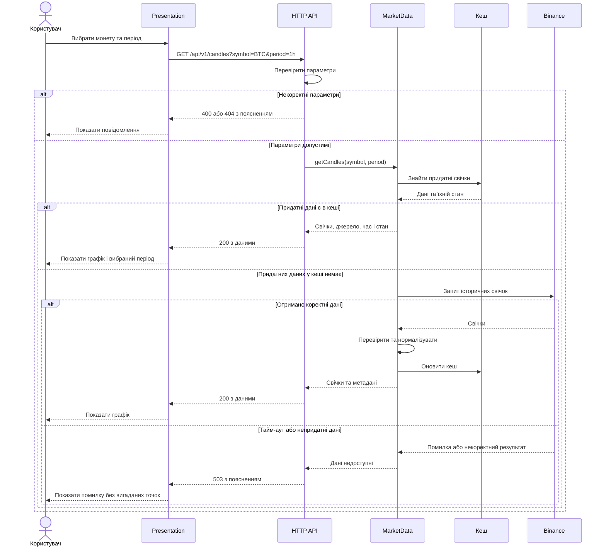
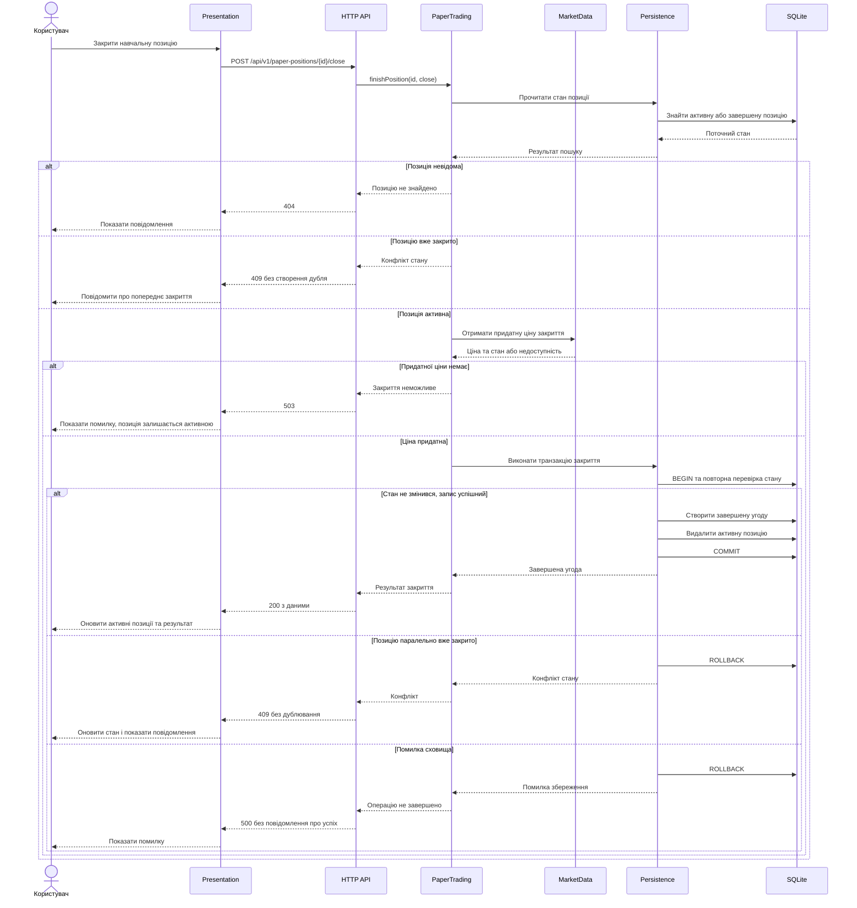

# План інтеграції

## 1. Статус документа

Версія 0.1 — запропонований план інтеграції.

Документ описує взаємодію модулів, порядок їх перевірки,
контракти обміну та обробку помилок.

Діаграми показують очікувану поведінку.
Вони не підтверджують, що така взаємодія вже реалізована
або перевірена в наявному прототипі.

Написання нового коду не є метою цієї навчальної роботи.
Результати інтеграції можуть перевірятися
на прототипі, контрольованих прикладах і моделях відповідей.

## 2. Мета інтеграції

Перевірити, що частини системи узгоджено забезпечують:

- перегляд ринку та графіків;
- отримання новин і пояснення їхнього походження;
- передачу станів помилок до інтерфейсу;
- незмінність початкових записів сигналів;
- узгоджені зміни навчальних угод.

Перший етап охоплює FR-01–FR-08.
Сигнали та навчальні угоди перевіряються
після включення відповідних розширень.

## 3. Учасники взаємодії

| Частина | Роль |
|---|---|
| Presentation | Дії користувача, запити API та відображення результатів |
| HTTP API | Перевірка структури запиту та формування відповіді |
| MarketData | Котирування, свічки й стан ринкових даних |
| News | Публікації та перевірка походження |
| SignalResearch | Сигнали, журнал і подальші результати |
| PaperTrading | Навчальні позиції та статистика |
| Persistence | Узгоджені операції з постійним сховищем |
| Binance | Зовнішнє джерело ринкових даних |
| RSS-джерела | CoinTelegraph і CoinDesk |

HTTP API є транспортним шаром,
а не окремим бізнес-модулем.

## 4. Контракти між частинами

| Взаємодія | Вхід | Очікуваний результат | Помилки та обмеження |
|---|---|---|---|
| Presentation → HTTP API | Параметри запиту або JSON | Дані у форматі api.md | Валідація, відсутній запис, недоступність |
| HTTP API → MarketData | Символ і період або запит котирувань | Нормалізовані дані, джерело, час і стан | Непідтримуваний актив, збій джерела |
| HTTP API → News | Запит списку новин | Публікації та попередження | Порожній список, часткова або повна недоступність |
| MarketData → Binance | Погоджена торгова пара та параметри | Котирування або свічки | Тайм-аут, некоректний формат, відсутність даних |
| News → RSS-джерела | Запит налаштованої стрічки | Вміст RSS | Тайм-аут, недоступність, помилка розбору |
| SignalResearch → MarketData і News | Запит придатних даних | Дані з обмеженнями використання | Недостатність або неактуальність |
| SignalResearch → Persistence | Знімок сигналу або результат горизонту | Збережений запис | Збій запису, дублювання |
| PaperTrading → MarketData | Запит ціни для закриття | Придатна ціна та її джерело | Придатна ціна відсутня |
| PaperTrading → Persistence | Перевірена операція з угодою | Узгоджена зміна стану | Відкат при помилці, конфлікт повторного закриття |

Усі маршрути HTTP мають запропонований префікс /api/v1.
Точні поля та коди відповідей визначено в api.md.

## 5. Діаграма послідовності №1: відкриття графіка

Сценарій: UC-01.
Вимоги: FR-04, FR-05, FR-08.
Заплановані перевірки: TC-07–TC-09, TC-15.

### Умови узгодженості

- Монета у відповіді відповідає вибору користувача.
- Період відповідає параметру запиту.
- Відповідь містить джерело та час отримання.
- Порожній графік не маскує помилку.
- Параметри запиту не використовуються
  для звернення до довільного стороннього URL.

## 6. Діаграма послідовності №2: закриття навчальної позиції

Сценарій: UC-04.
Вимога: FR-13.
Заплановані перевірки: TC-23, TC-24.

Цей сценарій не входить до першого MVP.

### Умови узгодженості

- Ціну закриття визначає сервер.
- Демонстраційна або непридатна ціна не використовується.
- Перевірка стану повторюється всередині транзакції.
- Створення завершеної угоди та видалення активної позиції
  або виконуються разом, або відкочуються.
- Повторне закриття не створює дубль.
- Журнал сигналів не змінюється.
- Реальний біржовий ордер не надсилається.

## 7. Послідовність інтеграції

| Етап | Що поєднується | Очікуваний результат |
|---|---|---|
| INT-01 | Presentation та API на контрольованих відповідях | Правильне відображення даних, порожніх станів і помилок |
| INT-02 | MarketData та зовнішнє джерело | Нормалізовані котирування й свічки зі станом даних |
| INT-03 | News та RSS-джерела | Публікації, походження та обмеження |
| INT-04 | Основний шлях першого MVP | Узгоджена робота пошуку, графіків і новин |
| INT-05 | Persistence та тестова SQLite | Узгоджене збереження без зміни робочої бази |
| INT-06 | SignalResearch, дані та Persistence | Незмінний сигнал і окремі результати горизонтів |
| INT-07 | PaperTrading, MarketData та Persistence | Коректні навчальні операції без дублювання |

Це порядок підготовки й перевірки,
а не твердження про завершені етапи.

## 8. Контрольовані зовнішні відповіді

Для перевірки потрібно підготувати приклади:

- коректних котирувань;
- коректних свічок;
- порожнього набору;
- некоректного формату;
- тайм-ауту;
- відповіді про обмеження частоти запитів;
- застарілих даних;
- новини без дати;
- посилання на сторонній домен;
- часткової недоступності RSS-джерел.

Контрольовані приклади мають бути явно позначені.
Вони не подаються як справжні поточні ринкові дані.

Для повторюваних негативних перевірок бажано
використовувати контрольовані відповіді,
а не чекати реального збою зовнішнього сервісу.

## 9. Правила обробки збоїв

- Для мережевих звернень потрібні обмежені тайм-аути.
- Кількість повторних спроб не повинна бути необмеженою.
- Помилка одного RSS-джерела не приховує доступні дані іншого.
- Раніше отримані дані супроводжуються часом і попередженням.
- Недоступність не підміняється нульовою ціною.
- Невдале збереження не подається як успішне.
- Після перезапуску потрібно уникати дублювання фонових задач.
- Порожній журнал або список позицій не є внутрішньою помилкою.

Точні тайм-аути, кількість повторів,
пороги актуальності та періоди фонового оновлення
ще потрібно погодити.

До погодження цих параметрів відповідні перевірки
не можуть вважатися повністю визначеними.

## 10. Заплановані інтеграційні перевірки

| ID | Сценарій | Очікуваний результат |
|---|---|---|
| IT-01 | Пошук і відкриття графіка | Вибрані монета та період зберігаються в запиті й відповіді |
| IT-02 | Недоступність свічок | API повертає помилку, інтерфейс не малює вигадані дані |
| IT-03 | Збій одного RSS-джерела | Доступні публікації показані з попередженням про частковий збій |
| IT-04 | Застарілі котирування | Інтерфейс показує попередження, новий сигнал не створюється |
| IT-05 | Запис і повторне читання сигналу | Початкові умови та версія правил не змінюються |
| IT-06 | Результат сигналу ще невідомий | Передається відповідний стан і null, а не нуль |
| IT-07 | Закриття навчальної позиції | Завершена угода створена один раз, активну позицію прибрано |
| IT-08 | Помилка під час закриття | Транзакцію відкочено, часткових змін немає |
| IT-09 | Повторне закриття | Дубль не створено, повернуто конфлікт |
| IT-10 | Скидання навчальних угод | Угоди очищено, журнал сигналів збережено |
| IT-11 | Запуск перевірок запису | Робоча база залишається незмінною |

IT-04 у частині сигналів та IT-05–IT-10
виконуються після включення відповідних розширень.

Це початковий перелік.
Детальні кроки, дані та очікувані відповіді
потрібно оформити в тестовій документації.

## 11. Умови початку перевірки

- Визначено конкретну версію документів або прототипу.
- Погоджено контракти потрібних операцій.
- Підготовлено контрольовані відповіді джерел.
- Для операцій запису налаштовано окрему тестову базу.
- Визначено очікувані результати.
- Погоджено параметри, від яких залежить перевірка.
- Забезпечено спосіб зберегти докази виконання.

## 12. Умови завершення

Етап інтеграції можна вважати перевіреним, якщо:

- виконано визначені для нього перевірки;
- очікувані та фактичні результати зіставлено;
- відхилення записано як дефекти або відкриті питання;
- критичні суперечності усунено;
- збережено докази та зазначено версію;
- результат переглянуто іншим учасником команди.

Збіг діаграми з очікуваннями не замінює
фактичного виконання перевірок.

## 13. Фіксація результатів

Після виконання для кожної перевірки записуються:

- її ідентифікатор;
- перевірена версія;
- фактична дата;
- середовище;
- вхідні дані;
- очікуваний результат;
- фактичний результат;
- статус;
- посилання на докази або дефект.

Допустимі статуси:

- Not run — не виконувалася;
- Passed — фактичний результат відповідає очікуваному;
- Failed — виявлено невідповідність;
- Blocked — виконання неможливе через зазначену перешкоду.

На момент підготовки цього плану
результати інтеграційних перевірок не зафіксовані.

## 14. Пов’язані документи

- [Архітектура системи](architecture.md)
- [Модулі та залежності](modules.md)
- [Контракт API](api.md)
- [Діаграма класів](class-diagram.md)
- [Сценарії використання](use-cases.md)
- [Специфікація вимог](../1-lifecycle/srs.md)
- [Трасування вимог](../1-lifecycle/traceability.md)
