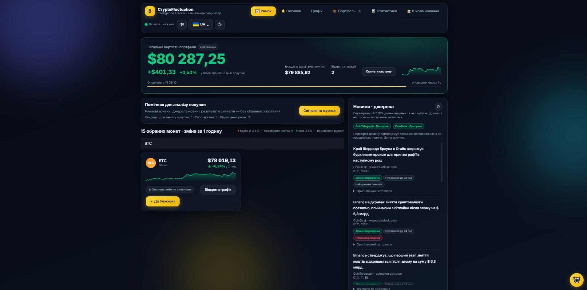
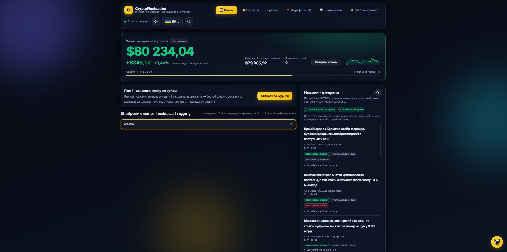
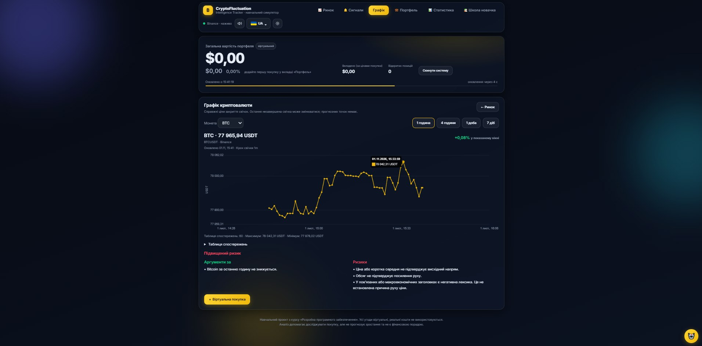
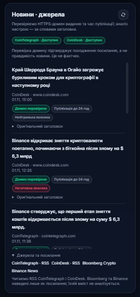
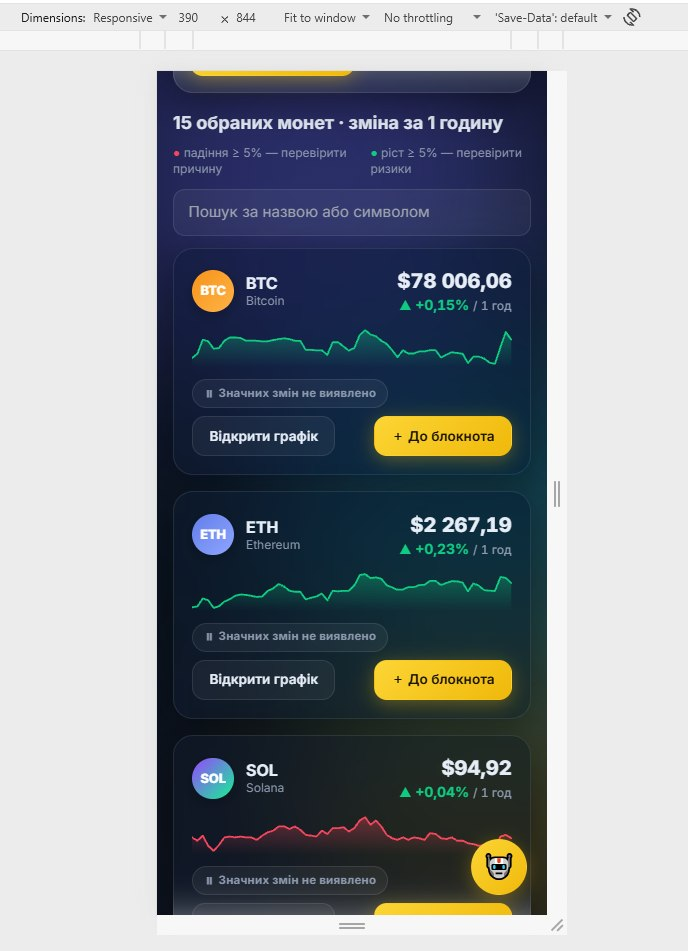

# Прототип інтерфейсу

## 1. Статус

Початкова версія опису прототипу CryptoFluctuation Intelligence Tracker.

За основу пропонується наявний локальний вебзастосунок.
Використання наявного сайту як навчального прототипу
потребує погодження викладача.

Додано матеріали P-01, P-02, P-03, P-04 та P-06.
Інші заплановані матеріали ще потрібно підготувати.

У стані P-03 виявлено розбіжність із FR-02:
за відсутності збігів не показано повідомлення про відсутність результатів.

Для одного посилання новини користувач виконав ручну перевірку:
стаття Cointelegraph відкрилася в новій вкладці,
а вкладка застосунку залишилася відкритою.

Ця перевірка не підтверджує виконання всіх критеріїв FR-06.

Скриншоти ілюструють окремі стани інтерфейсу,
але не підтверджують повного виконання вимог
або успішного проходження всіх перевірок.

Комплект прототипу залишається незавершеним.

## 2. Мета прототипу

Показати основний шлях користувача першого MVP:

відкрити ринок → знайти монету → переглянути графік →
прочитати новину → відкрити першоджерело →
зрозуміти обмеження даних.

Прототип має показувати не лише успішні дії,
а й порожні стани та помилки.

## 3. Межі першого MVP

До першого MVP належать FR-01–FR-08:

- список вибраних криптовалют;
- пошук за назвою або символом;
- оновлення котирувань;
- відкриття графіка;
- вибір періоду;
- новини з оригінальними посиланнями;
- пояснення перевірки походження;
- попередження про обмеження даних.

Сигнали, журнал і навчальні угоди належать
до наступних розширень.

Наявність цих розділів у робочому сайті
не робить їх автоматично частиною першого MVP.

## 4. Формат матеріалів

Використовуються або плануються:

- скриншоти наявних екранів;
- окремо позначені макети станів, яких поки немає;
- пояснення дій користувача;
- зв’язки з вимогами та сценаріями.

Скриншот реалізації та проєктний макет
не повинні подаватися як однакові докази.

Для кожного матеріалу зазначаються:

- фактична назва файлу;
- тип матеріалу;
- пов’язані вимоги;
- показаний стан або дія;
- обмеження доказовості.

Версія прототипу та дата отримання додаються,
якщо їх можна достовірно встановити.
Невідомі значення не вигадуються.

## 5. План екранів першого MVP

Назви файлів для відсутніх матеріалів є запланованими.
Посилання на них додаються лише після завантаження.

| ID | Екран або стан | Файл | Вимоги | Стан матеріалу |
|---|---|---|---|---|
| P-01 | Ринок і список монет | 01-market.png | FR-01, FR-02, FR-03, FR-06 | Додано; показано окремий видимий стан |
| P-02 | Пошук із результатом | 02-search-result.png | FR-02 | Додано; показано один приклад пошуку |
| P-03 | Пошук без результатів | 03-search-empty.png | FR-02 | Додано; виявлено розбіжність із вимогою |
| P-04 | Графік вибраної монети | 04-chart.png | FR-04, FR-05 | Додано; потрібна перевірка дій і всіх періодів |
| P-05 | Помилка завантаження графіка | 05-chart-error.png | FR-05, FR-08 | Не додано |
| P-06 | Новини та джерела | 06-news.png | FR-06, FR-07 | Додано; для одного посилання перевірено відкриття в новій вкладці |
| P-07 | Відсутність новин | 07-news-empty.png | FR-06, FR-08 | Не додано |
| P-08 | Недоступність джерела новин | 08-news-error.png | FR-08 | Не додано |
| P-09 | Демонстраційні дані | 09-demo-warning.png | FR-08 | Не додано |
| P-10 | Застарілі або недоступні котирування | 10-market-warning.png | FR-08 | Не додано |
| P-11 | Основний екран на ширині 390 пікселів | 11-mobile-market.png | NFR-03 | Не додано |

Додавання матеріалу не означає автоматичного
підтвердження відповідної вимоги.

## 6. Очікувана поведінка екранів

Цей розділ описує очікувану поведінку.
Фактичні спостереження наведено в розділі 12.

### P-01. Ринок

Користувач бачить вибрані монети,
доступні ціни в USDT, годинну зміну та джерело.

Для позначення MATIC потрібно пояснити
використання пари POLUSDT після міграції.

Один скриншот не підтверджує повноту списку
або періодичність оновлення.
Для FR-03 потрібне окреме спостереження чи перевірка.

### P-02. Пошук із результатом

Введений запит і відповідні монети видно одночасно.

Пошук має працювати за назвою або символом
без залежності від регістру.

Очищення запиту має повертати повний список.

### P-03. Пошук без результатів

Очікується зрозуміле повідомлення про відсутність збігів.
Користувач може змінити або очистити запит.

У доданому матеріалі повідомлення відсутнє.
Це розбіжність із критерієм приймання FR-02,
а не правильний зразок очікуваного порожнього стану.

### P-04. Графік

Мають бути видимі:

- вибрана монета й торгова пара;
- джерело;
- час оновлення;
- вибраний період;
- графік.

Доступні періоди: 1 година, 4 години, 1 доба та 7 діб.

Наявність кнопок не підтверджує правильності перемикання.
Кожен період потрібно перевірити окремо.

### P-05. Помилка графіка

Користувач бачить повідомлення про недоступність даних.

Вигадані точки не створюються для заповнення графіка.
Порожній графік не подається як успішне завантаження.

### P-06. Новини

Для новини показано заголовок, видавця,
оригінальне посилання та дату, якщо вона доступна.

Невідома дата не вигадується.

Пояснення перевірки походження не створює враження,
що зміст новини перевірено на правдивість.

Перевірку HTTPS і відповідності домену заявленому видавцю
потрібно перевіряти окремими сценаріями.

Оригінальне посилання має відкриватися в новій вкладці.
Для одного посилання цю поведінку вже перевірено користувачем.
Інші посилання та критерії потребують окремих перевірок.

### P-07. Відсутність новин

Показано зрозумілий порожній стан
без вигаданих публікацій.

### P-08. Помилка джерела новин

Повідомлення про збій відрізняється
від повідомлення про відсутність публікацій.

Якщо показано раніше отримані новини,
обмеження оновлення зазначено явно.

### P-09. Демонстраційні дані

Позначка «Демонстраційні дані» помітна
поруч із відповідними значеннями.

Такі значення не подаються як поточні ринкові дані
та не використовуються для створення нових
дослідницьких сигналів.

### P-10. Обмеження котирувань

За показу збережених значень видно час отримання
та попередження про можливу неактуальність.

Недоступна ціна не підміняється нулем.

Застарілі дані не використовуються
для створення нових дослідницьких сигналів.

### P-11. Мобільний вигляд

Основні елементи залишаються доступними
на ширині області перегляду 390 пікселів.

Горизонтальне прокручування широкої таблиці
може бути локальним, але не повинно
створювати прокручування всієї сторінки.

Один екран не підтверджує адаптивність усіх розділів.
Для NFR-03 також потрібна перевірка ширини 1440 пікселів.

## 7. Правила підготовки матеріалів

- Знімати лише потрібну область інтерфейсу.
- Не публікувати секрети, робочу базу або приватні повідомлення.
- Не приховувати помилки, важливі для оцінки прототипу.
- Не редагувати скриншот так, щоб він імітував
  відсутню в реалізації поведінку.
- Якщо створено макет, підписати його як макет.
- Для контрольованого збою зазначити спосіб відтворення.
- Не змінювати робочі дані заради демонстрації.
- Для операцій запису використовувати тестове середовище.

Якщо стан поки неможливо відтворити,
його матеріал залишається відсутнім
або готується окремий явно позначений макет.

## 8. Шаблон опису нового матеріалу

Для кожного нового зображення додається запис:

### P-XX. Назва

- Файл: фактична назва.
- Тип: скриншот реалізації або проєктний макет.
- Версія прототипу: якщо відома.
- Дата отримання: якщо достовірно відома.
- Вимоги: ідентифікатори.
- Дія користувача: опис.
- Що показано: опис.
- Обмеження: що не підтверджується зображенням.
- Виявлені розбіжності: якщо є.
- Ручна перевірка: фактичні кроки й результат, якщо виконувалася.

Після завантаження зображення додається
його відносне Markdown-посилання.

## 9. Подальші розширення

Окремі матеріали можуть показувати:

- аргументи й ризики сигналу;
- журнал і результати через 1, 4 та 24 години;
- навчальні позиції та статистику;
- освітню довідку;
- вибір мови.

Вони позначаються як розширення,
а не як обов’язкові екрани першого MVP.

## 10. Критерії готовності комплекту

- Додано екрани основного шляху.
- Показано потрібні порожні стани й помилки.
- Макети відділено від скриншотів реалізації.
- Кожен матеріал пов’язано з вимогами.
- Посилання на зображення працюють.
- Немає приватних даних і секретів.
- Виявлені розбіжності записано в беклог.
- Комплект переглянуто іншим учасником команди.
- Фактичні перевірки та їхні результати зафіксовано окремо.

Це критерії готовності, а не перелік уже виконаних робіт.
До виконання цих умов комплект залишається незавершеним.

## 11. Пов’язані документи

- [Бачення продукту](../../0-product/vision.md)
- [Специфікація вимог](../../1-lifecycle/srs.md)
- [Межі MVP](../../1-lifecycle/mvp.md)
- [Трасування вимог](../../1-lifecycle/traceability.md)
- [План ітерації та беклог](../../1-lifecycle/sprint-plan.md)
- [Сценарії використання](../use-cases.md)
- [Архітектура системи](../architecture.md)

## 12. Додані матеріали

### P-01. Екран ринку

- Тип: скриншот наявного вебзастосунку.
- Пов’язані вимоги: FR-01, FR-02, FR-03, FR-06.
- Показано: початковий екран ринку, порожнє поле пошуку,
  картки монет, ціни, годинну зміну та блок новин.
- Обмеження: у кадрі видно лише частину списку монет.
  Зображення не підтверджує повноту списку, роботу пошуку,
  періодичність оновлення або доступність зовнішніх джерел.
- Відображення символу долара саме по собі
  не підтверджує явного позначення валюти USDT.
  Відповідність цьому критерію FR-01 потрібно перевірити окремо.

### P-02. Пошук із результатом

- Тип: скриншот наявного вебзастосунку.
- Пов’язана вимога: FR-02.
- Дія користувача: введено BTC у поле пошуку.
- Показано: запит BTC та одну картку Bitcoin.
- Обмеження: зображення не підтверджує пошук
  за повною назвою, незалежність від регістру
  або повернення повного списку після очищення запиту.

### P-03. Пошук без результатів

- Тип: скриншот наявного вебзастосунку.
- Пов’язана вимога: FR-02.
- Дія користувача: введено запит wwww.
- Показано: запит і відсутність карток монет.
- Виявлена розбіжність: повідомлення про відсутність
  результатів не показано.
- Очікувана поведінка: показати зрозуміле повідомлення,
  наприклад «Нічого не знайдено».
- Подальша дія: оформити дефект і пов’язати його з FR-02.
- Цей матеріал не підтверджує повного виконання FR-02.

### P-04. Графік BTC

- Тип: скриншот наявного вебзастосунку.
- Пов’язані вимоги: FR-04, FR-05.
- Показано: BTC, пару BTCUSDT, джерело Binance,
  час оновлення, вибраний період «1 година» та графік.
- Видно кнопки періодів: 1 година, 4 години, 1 доба та 7 діб.
- Обмеження: один скриншот не підтверджує
  перемикання всіх періодів, правильність завантаження
  вибраної монети або достовірність зовнішніх даних.
- Блок пояснення сигналу внизу належить
  до розширення поза першим MVP.

### P-06. Новини та джерела

- Тип: скриншот наявного вебзастосунку.
- Пов’язані вимоги: FR-06, FR-07.
- Показано: заголовки, видавців, дати публікацій,
  позначки перевірки домену та пояснення,
  що перевірка походження не є фактчеком.
- У розгорнутому блоці наведено пояснення джерел і посилань.
- Обмеження скриншота: зображення саме по собі
  не підтверджує доступність зовнішніх джерел,
  правильність дат, роботу перевірки домену
  або відкриття оригіналу в новій вкладці.
- Позначка «Домен перевірено» не є доказом
  правдивості змісту публікації.

#### Виконана ручна перевірка

- Виконавець: Іван Носатов.
- Дія: натиснуто посилання однієї новини в застосунку.
- Очікуваний результат: оригінальна стаття відкривається
  в новій вкладці, а вкладка застосунку залишається відкритою.
- Фактичний результат: відкрилася стаття Cointelegraph
  «DeepSeek developing AI agent requiring less human input: Report».
  Користувач підтвердив відкриття в новій вкладці.
- Адреса відкритої статті:
  https://cointelegraph.com/news/deepseek-developing-ai-agent-requiring-less-human-input-report
- Підтвердження: користувач надав скриншот відкритої статті
  в робочому листуванні та окремо підтвердив нову вкладку.
  Скриншот цієї перевірки до репозиторію ще не додано.
- Результат: критерій відкриття посилання в новій вкладці
  виконано для одного перевіреного прикладу.
- Обмеження: це не підтверджує виконання всіх критеріїв FR-06,
  правильність усіх посилань або правдивість публікації.
- Подальша дія: перевірити інші посилання та окремі
  позитивні й негативні сценарії перевірки походження.
  
### P-11. Мобільний вигляд ринку

- Тип: скриншот наявного вебзастосунку в мобільному режимі Chrome DevTools.
- Пов’язана вимога: NFR-03.
- Розмір області перегляду: 390 × 844 CSS-пікселі.
- Показано: поле пошуку, картки BTC та ETH,
  частину картки SOL і кнопки відкриття графіка.
- Спостереження: у показаній області поле пошуку
  та повністю видимі картки вкладаються в ширину екрана.
- Обмеження: скриншот не підтверджує відсутності
  горизонтального прокручування всієї сторінки,
  працездатності кнопок або адаптивності інших екранів.
  Перевірка ширини 1440 пікселів також залишається потрібною.
- NFR-03 не позначається як повністю перевірена.
