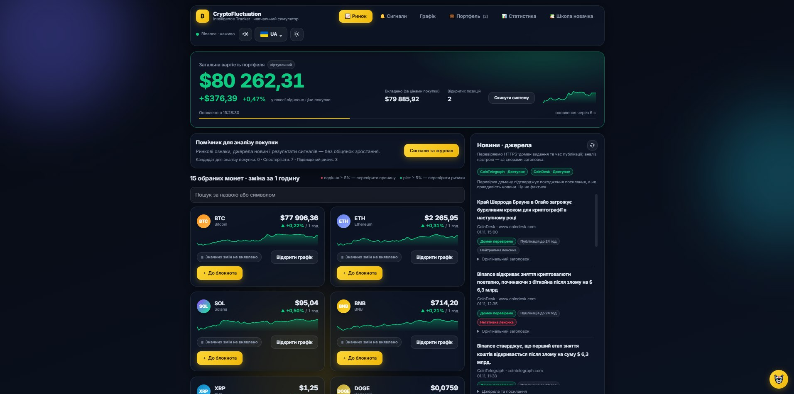

# Прототип інтерфейсу

## 1. Статус

Початкова версія опису прототипу.

За основу пропонується наявний локальний вебзастосунок
CryptoFluctuation Intelligence Tracker.

Використання наявного сайту як навчального прототипу
потребує погодження викладача.

Скриншоти та їхню відповідність вимогам
ще потрібно додати й перевірити.

Цей документ не підтверджує успішне тестування.

## 2. Мета прототипу

Показати основний шлях користувача першого MVP:

відкрити ринок → знайти монету → переглянути графік →
прочитати новину → відкрити першоджерело →
зрозуміти обмеження даних.

Прототип має показувати не лише успішні дії,
а й порожні стани та помилки.

## 3. Межі першого MVP

До першого MVP належать FR-01–FR-08:

- список вибраних криптовалют;
- пошук за назвою або символом;
- оновлення котирувань;
- відкриття графіка;
- вибір періоду;
- новини з оригінальними посиланнями;
- пояснення перевірки походження;
- попередження про обмеження даних.

Сигнали, журнал і навчальні угоди належать
до наступних розширень.

Наявність цих розділів у робочому сайті
не робить їх автоматично частиною першого MVP.

## 4. Формат матеріалів

Планується додати:

- скриншоти наявних екранів;
- окремо позначені макети станів, яких поки немає;
- пояснення дій користувача;
- зв’язки з вимогами та сценаріями.

Скриншот реалізації та проєктний макет
не повинні подаватися як однакові докази.

Для кожного матеріалу потрібно зазначити:

- чи це екран наявного сайту, чи макет;
- які вимоги він ілюструє;
- що на ньому можна перевірити;
- які обмеження залишаються.

## 5. План екранів першого MVP

Назви файлів нижче є запланованими.
До завантаження зображень вони не є посиланнями.

| ID | Екран або стан | Запланований файл | Вимоги | Стан матеріалу |
|---|---|---|---|---|
| P-01 | Ринок і список монет | 01-market.png | FR-01, FR-03 | Не додано |
| P-02 | Пошук із результатом | 02-search-result.png | FR-02 | Не додано |
| P-03 | Пошук без результатів | 03-search-empty.png | FR-02 | Не додано |
| P-04 | Графік вибраної монети | 04-chart.png | FR-04, FR-05 | Не додано |
| P-05 | Помилка завантаження графіка | 05-chart-error.png | FR-05, FR-08 | Не додано |
| P-06 | Новини та джерела | 06-news.png | FR-06, FR-07 | Не додано |
| P-07 | Відсутність новин | 07-news-empty.png | FR-06, FR-08 | Не додано |
| P-08 | Недоступність джерела новин | 08-news-error.png | FR-08 | Не додано |
| P-09 | Демонстраційні дані | 09-demo-warning.png | FR-08 | Не додано |
| P-10 | Застарілі або недоступні котирування | 10-market-warning.png | FR-08 | Не додано |
| P-11 | Основний екран на ширині 390 пікселів | 11-mobile-market.png | NFR-03 | Не додано |

Статус матеріалу змінюється лише після
його фактичного додавання та перегляду.

## 6. Очікувана поведінка екранів

### P-01. Ринок

Користувач бачить вибрані монети,
доступні ціни в USDT, годинну зміну та джерело.

Для позначення MATIC потрібно пояснити
використання пари POLUSDT після міграції.

Один скриншот не підтверджує періодичність оновлення.
Для FR-03 потрібне окреме спостереження або перевірка.

### P-02. Пошук із результатом

Введений запит і відповідні монети видно одночасно.

Пошук має працювати за назвою або символом
без залежності від регістру.

### P-03. Пошук без результатів

Показано зрозуміле повідомлення про відсутність збігів.
Користувач може змінити або очистити запит.

### P-04. Графік

Видно:

- вибрану монету й торгову пару;
- джерело;
- час оновлення;
- вибраний період;
- графік.

Доступні періоди: 1 година, 4 години, 1 доба та 7 діб.

### P-05. Помилка графіка

Користувач бачить повідомлення про недоступність.
Вигадані точки не створюються для заповнення графіка.

### P-06. Новини

Для новини показано заголовок, видавця,
оригінальне посилання та доступну дату.

Пояснення перевірки походження не створює враження,
що зміст новини перевірено на правдивість.

Відкриття посилання в новій вкладці
потрібно перевірити окремою дією.

### P-07. Відсутність новин

Показано порожній стан без вигаданих публікацій.

### P-08. Помилка джерела новин

Повідомлення про збій відрізняється
від повідомлення про відсутність публікацій.

Якщо показано раніше отримані новини,
обмеження оновлення зазначено явно.

### P-09. Демонстраційні дані

Позначка «Демонстраційні дані» помітна
поруч із відповідними значеннями.

Такий матеріал не подається як поточне ринкове спостереження.

### P-10. Обмеження котирувань

За показу збережених значень видно час отримання
та попередження про можливу неактуальність.

Недоступна ціна не підміняється нулем.

### P-11. Мобільний вигляд

Основні елементи залишаються доступними
на ширині області перегляду 390 пікселів.

Горизонтальне прокручування широкої таблиці
може бути локальним, але не повинно
створювати прокручування всієї сторінки.

Один екран не підтверджує адаптивність усіх розділів.

## 7. Правила підготовки матеріалів

- Знімати лише потрібну область інтерфейсу.
- Не публікувати секрети, робочу базу або приватні повідомлення.
- Не приховувати помилки, важливі для оцінки прототипу.
- Не редагувати скриншот так, щоб він імітував
  відсутню в реалізації поведінку.
- Якщо створено макет, підписати його як макет.
- Для контрольованого збою зазначити спосіб відтворення.
- Не змінювати робочі дані заради демонстрації.
- Для операцій запису використовувати тестове середовище.

Якщо стан поки неможливо відтворити,
його матеріал залишається відсутнім
або готується окремий явно позначений макет.

## 8. Опис доданого матеріалу

Для кожного завантаженого зображення
потрібно додати запис за шаблоном:

### P-XX. Назва

- Файл: зазначити фактичну назву.
- Тип: скриншот реалізації або проєктний макет.
- Версія прототипу: зазначити, якщо відома.
- Дата отримання: записати фактичну дату.
- Вимоги: зазначити ідентифікатори.
- Дія користувача: описати.
- Що показано: описати.
- Обмеження: зазначити, що не підтверджується зображенням.

Після завантаження зображення додається
його відносне Markdown-посилання.

## 9. Подальші розширення

Окремі матеріали можуть показувати:

- аргументи й ризики сигналу;
- журнал і результати через 1, 4 та 24 години;
- навчальні позиції та статистику;
- освітню довідку;
- вибір мови.

Вони позначаються як розширення,
а не як обов’язкові екрани першого MVP.

## 10. Критерії готовності комплекту

- Додано екрани основного шляху.
- Показано потрібні порожні стани й помилки.
- Макети відділено від скриншотів реалізації.
- Кожен матеріал пов’язано з вимогами.
- Посилання на зображення працюють.
- Немає приватних даних і секретів.
- Виявлені розбіжності записано в беклог.
- Комплект переглянуто іншим учасником команди.

До виконання цих умов комплект прототипу
залишається незавершеним.

## 11. Пов’язані документи

- [Бачення продукту](../../0-product/vision.md)
- [Специфікація вимог](../../1-lifecycle/srs.md)

 
 ## 12. Додані матеріали

### P-01. Екран ринку

- Тип: скриншот наявного вебзастосунку.
- Пов’язані вимоги: FR-01, FR-02, FR-06.
- Показано: початковий екран ринку, порожнє поле пошуку,
  картки монет, ціни, годинну зміну та блок новин.
- Обмеження: у кадрі видно лише частину списку монет.
  Зображення не підтверджує роботу пошуку,
  періодичність оновлення або доступність джерел.
- [Межі MVP](../../1-lifecycle/mvp.md)
- [Трасування вимог](../../1-lifecycle/traceability.md)
- [Сценарії використання](../use-cases.md)
- [Архітектура системи](../architecture.md)
