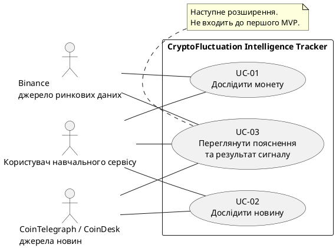

# Сценарії використання

## 1. Статус документа

Версія 0.1 — проєкт сценаріїв для обговорення.

Документ описує очікувану взаємодію користувача із системою.
Це не звіт про вже проведені перевірки.

UC-01 і UC-02 належать до першого MVP.
UC-03 описує наступне розширення із сигналами.
UC-04 і UC-05 наведено стисло для узгодженості з трасуванням.

## 2. Межі системи та актори

Система: CryptoFluctuation Intelligence Tracker.

Основний актор:
користувач навчального сервісу.

Зовнішні допоміжні актори:

- джерело ринкових даних Binance;
- джерела новин CoinTelegraph і CoinDesk.

Окремі ролі адміністратора або зареєстрованого трейдера
не передбачені.

Система не виконує реальних торгових операцій.

## 3. UML-діаграма варіантів використання

Нижче наведено вихідний код UML-діаграми у форматі PlantUML.

GitHub показує цей блок як текст, а не як готове зображення.
Для графічного подання потрібно окремо експортувати діаграму
у SVG або PNG та додати зображення до репозиторію.

Лінії показують участь акторів, а не порядок дій.
Послідовність взаємодії описана в сценаріях нижче.

## 4. UC-01. Дослідити монету

### Мета

Знайти потрібну монету та переглянути історію її ціни,
розуміючи джерело й обмеження даних.

### Актори

- Основний: користувач навчального сервісу.
- Допоміжний: Binance.

### Обсяг

Перший MVP.

### Пов’язані вимоги

FR-01, FR-02, FR-03, FR-04, FR-05, FR-08.
NFR-01, NFR-03, NFR-06.

### Передумови

- Сервіс запущено.
- Користувач відкрив інтерфейс у браузері.
- Для основного потоку зовнішнє джерело доступне.

### Тригер

Користувач відкриває сторінку ринку.

### Основний потік

1. Система показує список 15 вибраних монет.
2. Для доступних котирувань система показує ціну,
   валюту USDT, годинну зміну та джерело.
3. Користувач вводить назву або символ монети.
4. Система показує відповідні результати без залежності
   від регістру введення.
5. Користувач натискає кнопку графіка потрібної монети.
6. Система відкриває графік вибраної монети.
7. Система показує символ, торгову пару,
   джерело та час оновлення.
8. Користувач вибирає період:
   1 година, 4 години, 1 доба або 7 діб.
9. Система показує дані за вибраний період
   та візуально позначає цей вибір.

У видимій активній вкладці клієнт планує оновлення
котирувань кожні 10 секунд без повного перезавантаження.

### Альтернативні потоки

#### A1. Порожній пошуковий запит

На кроці 3 користувач очищує поле.
Система повертає повний список монет.

#### A2. Монету не знайдено

На кроці 4 збігів немає.
Система показує повідомлення про відсутність результатів.
Користувач може змінити або очистити запит.

#### A3. Джерело котирувань недоступне

На кроці 2 система показує повідомлення про збій.

Якщо відображаються збережені значення,
зазначено час останнього успішного отримання
та попередження про можливу неактуальність.

#### A4. Дані графіка недоступні

На кроці 6 або 9 система показує помилку.
Порожній графік не подається як успішне завантаження.
Вигадані точки не додаються.

#### A5. Демонстраційні дані

Якщо використано демонстраційні значення,
вони мають видиму відповідну позначку.

#### A6. Перегляд MATIC

Система явно пояснює використання пари POLUSDT
після міграції токена.

### Постумови

Успішний результат:
користувач переглянув графік вибраної монети
та може визначити джерело й час оновлення.

Результат при помилці:
користувач отримав повідомлення про обмеження,
а не вигаданий успішний результат.

Жодного реального торгового ордера не створено.

### Заплановані перевірки

TC-01–TC-09, TC-14, TC-15.
QT-01, QT-03, QT-06.

## 5. UC-02. Дослідити новину

### Мета

Прочитати заголовок новини, перейти до оригіналу
та зрозуміти межі перевірки її походження.

### Актори

- Основний: користувач навчального сервісу.
- Допоміжні: CoinTelegraph і CoinDesk.

### Обсяг

Перший MVP.

### Пов’язані вимоги

FR-06, FR-07, FR-08.
NFR-03, NFR-06.

### Передумови

- Сервіс запущено.
- Користувач відкрив інтерфейс.
- Для основного потоку отримано новини із зовнішніх джерел.

### Тригер

Користувач відкриває розділ новин.

### Основний потік

1. Система показує отримані новини.
2. Для кожної новини система показує заголовок,
   видавця, посилання та доступну дату публікації.
3. Користувач переглядає пояснення походження новини.
4. Система пояснює перевірку HTTPS і відповідності
   домену заявленому видавцю.
5. Система зазначає, що перевірка походження
   не підтверджує правдивість змісту.
6. Користувач натискає посилання на новину.
7. Оригінальна публікація відкривається в новій вкладці.

### Альтернативні потоки

#### A1. Дата невідома

На кроці 2 система позначає відсутність дати
або не показує її як відому.
Дата не вигадується.

#### A2. Новин немає

На кроці 1 система показує порожній стан.
Вигадані публікації не додаються.

#### A3. Джерело недоступне

Система повідомляє про неможливість отримати новини.
Якщо показано раніше отриманий список,
користувач бачить попередження про обмеження оновлення.

#### A4. Сторонній домен або відсутність HTTPS

На кроці 4 посилання не позначається
як підтверджене HTTPS-посилання на заявленого видавця.

Користувач бачить відповідне обмеження перевірки.

#### A5. Оригінальна сторінка недоступна

На кроці 7 зовнішній сайт може не відкритися.
Система не гарантує доступність або незмінність
сторонньої публікації.

### Постумови

Успішний результат:
користувач отримав посилання на оригінал
і пояснення обмежень перевірки походження.

Результат при помилці:
відсутність новин або доступу не приховується
за вигаданим вмістом.

### Заплановані перевірки

TC-10–TC-15.
QT-03, QT-06.

## 6. UC-03. Переглянути пояснення та результат сигналу

### Мета

Зрозуміти початкові аргументи й ризики сигналу
та пізніше перевірити зміну ціни без підміни історичних даних.

### Актори

- Основний: користувач навчального сервісу.
- Допоміжні: Binance, CoinTelegraph і CoinDesk.

### Обсяг

Наступне розширення.
Не є умовою завершення першого MVP.

### Пов’язані вимоги

FR-08, FR-09, FR-10, FR-11.
NFR-02, NFR-04, NFR-06.

### Передумови

- Функції сигналів і журналу включено до обсягу версії.
- Сервіс запущено.
- Для основного потоку доступні достатні актуальні дані.
- Для перегляду історичного результату існує збережений сигнал.

### Тригер

Користувач відкриває пояснення сигналу
або запис у журналі.

### Основний потік

1. Користувач вибирає доступний сигнал.
2. Система показує його статус, аргументи,
   ризики та відсутні дані.
3. Користувач ознайомлюється з поясненнями.
4. Система попереджає, що сигнал не є наказом купувати
   та не гарантує прибутку.
5. Користувач відкриває відповідний запис журналу.
6. Система показує монету, час створення, початкову ціну,
   тип сигналу та версію правил аналізу.
7. Система показує збережений початковий знімок пояснень.
8. Для горизонтів 1, 4 і 24 години система показує
   доступний результат або відповідний стан очікування.
9. Для отриманого результату система показує зміну ціни,
   цільовий і фактичний час ринкового спостереження.
10. Система пояснює, що зміна ціни не є чистим прибутком
    і не враховує комісії, спред та прослизання.

Створення запису сигналу відбувається за правилами системи,
а не обов’язково внаслідок відкриття його користувачем.

### Альтернативні потоки

#### A1. Недостатньо актуальних даних

Новий дослідницький сигнал не створюється.
Показано стан недостатності даних.

Демонстраційні та застарілі дані
не використовуються для нового сигналу.

#### A2. Аргументів немає

На кроці 2 система прямо зазначає їхню відсутність.
Вигадані аргументи не додаються.

#### A3. Підвищений ризик

Система пояснює, що цей статус не означає
майбутнього зростання ціни або рекомендації купувати.

#### A4. Горизонт ще не настав

На кроці 8 показано стан очікування.
Результат не підміняється нулем.

#### A5. Результат недоступний

Після настання горизонту потрібне ринкове спостереження
може залишатися недоступним.

Система не вигадує результат і не показує його як нульовий.

#### A6. Змінилися правила аналізу

Початковий запис, його версія правил і знімок пояснень
залишаються незмінними.

#### A7. У журналі немає записів

Система показує порожній стан.
Історичні сигнали не створюються заднім числом.

### Постумови

Користувач бачить початкові умови сигналу
та доступний подальший результат або чесне пояснення,
чому результату ще немає.

Перегляд не змінює початковий запис.
Реальні торгові операції не виконуються.

### Заплановані перевірки

TC-16–TC-20.
QT-02, QT-04, QT-06.

## 7. Додаткові сценарії

### UC-04. Вести навчальні угоди

Обсяг: наступне розширення.

Пов’язані вимоги: FR-12–FR-16.
Заплановані перевірки: TC-21–TC-29.

Очікувана взаємодія:

1. Користувач вводить монету, кількість і ціну входу.
2. Система перевіряє значення.
3. Коректна позиція додається до навчального обліку.
4. Користувач може закрити позицію
   або видалити помилково додану.
5. Система показує місячну статистику завершених угод.
6. За потреби користувач скидає угоди з підтвердженням.

Основні винятки:

- некоректні значення не створюють запис;
- повторне закриття не створює дубль;
- видалення не імітує завершення угоди;
- скасування скидання не змінює дані;
- скидання угод не видаляє журнал сигналів.

Детальний опис потребує подальшого опрацювання.

### UC-05. Скористатися довідкою та мовними налаштуваннями

Обсяг: додаткові можливості.

Пов’язані вимоги: FR-17, FR-18.
Заплановані перевірки: TC-30, TC-31.

Очікувана взаємодія:

1. Користувач відкриває пояснення терміна.
2. Система показує визначення, приклад і застереження.
3. Користувач вибирає мову за текстовою назвою.
4. Система оновлює постійні написи без повного перезавантаження.

Зовнішні новини можуть залишатися мовою джерела.

Детальний опис потребує подальшого опрацювання.

## 8. Стан перевірки сценаріїв

- UC-01–UC-03 описано як очікувану поведінку.
- UC-04 і UC-05 наведено стисло.
- Код UML-діаграми підготовлено.
- Графічний експорт діаграми ще потрібно додати.
- Відповідність сценаріїв прототипу ще потрібно перевірити.
- Рев’ю іншим учасником команди ще потрібно зафіксувати.
- Результати виконання тест-кейсів у цьому документі не заявляються.

## 9. Пов’язані документи

- [Бачення продукту](../0-product/vision.md)
- [Специфікація вимог](../1-lifecycle/srs.md)
- [Межі MVP](../1-lifecycle/mvp.md)
- [Трасування вимог](../1-lifecycle/traceability.md)
- [План ітерації та беклог](../1-lifecycle/sprint-plan.md)
- [Журнал змін вимог](../1-lifecycle/changes.md)
