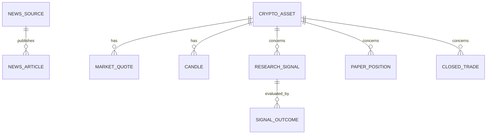

# Модель даних

## 1. Статус документа

Продукт: CryptoFluctuation Intelligence Tracker.
Версія документа: 0.1.
Статус: проєктна модель для обговорення командою.

Документ описує запропоновану структуру даних.

Відповідність таблиць і полів фактичній базі
наявного застосунку ще не перевірена.

Назви сутностей і полів є проєктними.
Вони не підтверджують наявності відповідних таблиць
або обмежень у реалізації.

У межах курсу цей документ не вимагає
створення нової бази або зміни робочих даних.

## 2. Призначення

Модель визначає:

- основні сутності продукту;
- їхні поля та зв’язки;
- правила цілісності;
- відмінність відсутніх значень від нуля;
- збереження початкових умов сигналу;
- відокремлення навчальних угод від журналу сигналів.

## 3. Межі моделі

### Перший MVP

FR-01–FR-08 використовують:

- довідник криптовалют;
- ринкові котирування;
- точки графіка;
- джерела новин;
- новини;
- відомості про походження та стан даних.

Не всі ці дані потрібно постійно зберігати в SQLite.
Котирування, графіки й новини можуть бути тимчасовим кешем.

Конкретний спосіб і строк зберігання кешу
потребують погодження.

### Подальші розширення

Після включення відповідних Should-функцій додаються:

- дослідницькі сигнали;
- результати сигналів;
- активні навчальні позиції;
- завершені навчальні угоди.

Таблиці користувачів і ролей не передбачені:
поточна область — локальний однокористувацький сервіс.

## 4. Загальні правила представлення даних

### 4.1. Ідентифікатори

Для сутностей передбачено стабільний первинний ключ.

Проєктна пропозиція для SQLite — INTEGER PRIMARY KEY.

Символ монети є окремим унікальним атрибутом,
а не заміною всіх внутрішніх ідентифікаторів.

### 4.2. Час

Часові значення представляються в UTC
у форматі ISO 8601, наприклад:

`2026-01-31T23:59:00Z`

Потрібно розрізняти:

- час спостереження джерела;
- час отримання застосунком;
- час створення запису;
- цільовий час перевірки результату.

Якщо час джерела невідомий,
він залишається NULL.
Час отримання не видається за час публікації чи спостереження.

### 4.3. Ціни та кількості

Ціни, кількості й результати потребують десяткової точності.

Проєктна пропозиція:

- передавати десяткові значення через API як рядки;
- обчислювати їх десятковою арифметикою;
- у SQLite зберігати як канонічний десятковий TEXT;
- не використовувати двійковий REAL
  для точного обліку навчальних угод.

Точність, масштаб і правила округлення
потрібно погодити перед реалізацією.

Обмеження додатності перевіряється після
коректного десяткового розбору значення.
Тип TEXT сам по собі цього не гарантує.

### 4.4. Відсутні значення

NULL означає невідоме або недоступне значення.

Нуль не використовується як заміна:

- недоступної ціни;
- невідомої дати;
- ще не отриманого результату сигналу.

### 4.5. Джерело та стан даних

Потрібно відокремлювати:

- походження: зовнішнє джерело або демонстраційний набір;
- свіжість: актуальність за погодженим правилом;
- результат останньої спроби отримання: успіх або збій.

Збережене зовнішнє значення після збою
не стає демонстраційним.
Воно потребує відповідного попередження.

Поріг застарілості ще потрібно визначити.

## 5. Логічна схема

Діаграма показує проєктні зв’язки.
Вона не є знімком фактичної структури SQLite.

Для кожної навчальної позиції допускається
не більше одного запису завершеної угоди.

Після закриття дані позиції переносяться
до незмінного знімка завершеної угоди
в межах однієї транзакції.

## 6. CryptoAsset — криптовалюта

Призначення: довідник підтримуваних активів.

| Поле | Тип | Обов’язковість | Значення |
|---|---|---|---|
| id | INTEGER | Так, PK | Внутрішній ідентифікатор |
| symbol | TEXT | Так, UNIQUE | Символ у продукті, наприклад BTC |
| name | TEXT | Так | Назва активу |
| market_pair | TEXT | Так | Пара джерела, наприклад BTCUSDT |
| quote_currency | TEXT | Так | Валюта котирування, для поточного обсягу USDT |
| mapping_note | TEXT | Ні | Пояснення відповідності символу й пари |

Для MATIC передбачено market_pair = POLUSDT
та явне пояснення міграції.

Символ у продукті й символ зовнішнього джерела
не повинні неявно ототожнюватися.

Видалення активу з історичними записами
не повинно руйнувати історію.
Потрібно використовувати обмеження видалення
або ознаку неактивності після погодження.

## 7. MarketQuote — ринкове котирування

Призначення: знімок отриманої ціни.

| Поле | Тип | Обов’язковість | Значення |
|---|---|---|---|
| id | INTEGER | Так, PK | Ідентифікатор знімка |
| asset_id | INTEGER | Так, FK | Посилання на CryptoAsset |
| market_pair | TEXT | Так | Фактично використана пара |
| price | Decimal TEXT | Так | Додатна ціна |
| quote_currency | TEXT | Так | Валюта ціни |
| change_1h_pct | Decimal TEXT | Ні | Відсоткова зміна за годину |
| source | TEXT | Так | Джерело або назва демонстраційного набору |
| observed_at | UTC TEXT | Ні | Час спостереження джерела |
| received_at | UTC TEXT | Так | Час отримання застосунком |
| provenance | TEXT | Так | external або demo |

Відсутність котирування представляється станом
недоступності, а не записом із вигаданою нульовою ціною.

Зміна за годину може бути від’ємною або нульовою.

Для її розрахунку потрібно окремо визначити,
які спостереження використовуються.
Відсутня історична ціна не замінюється вигаданою.

Стан останнього запиту та його помилка
зберігаються окремо від незмінного знімка ціни
або передаються в обгортці відповіді API.

## 8. Candle — точка історичного графіка

Призначення: отримані дані свічки для побудови графіка.

| Поле | Тип | Обов’язковість | Значення |
|---|---|---|---|
| id | INTEGER | Так, PK | Ідентифікатор |
| asset_id | INTEGER | Так, FK | Актив |
| market_pair | TEXT | Так | Фактична пара |
| source | TEXT | Так | Джерело |
| interval | TEXT | Так | Інтервал свічки |
| open_time | UTC TEXT | Так | Початок інтервалу |
| close_time | UTC TEXT | Так | Кінець інтервалу |
| close_price | Decimal TEXT | Так | Ціна закриття або поточне значення незавершеної свічки |
| is_closed | BOOLEAN | Так | Чи завершено свічку |
| received_at | UTC TEXT | Так | Час отримання |

Проєктний унікальний ключ:

`source + market_pair + interval + open_time`

Правила:

- ціна додатна;
- кінець інтервалу пізніший за початок;
- повторне отримання не створює дубль свічки;
- незавершена свічка може оновлюватися;
- прогнозні точки не створюються.

Період перегляду та інтервал свічки — різні поняття.
Відповідність між ними визначається окремим правилом.

## 9. NewsSource — джерело новин

| Поле | Тип | Обов’язковість | Значення |
|---|---|---|---|
| id | INTEGER | Так, PK | Ідентифікатор |
| name | TEXT | Так | Назва видавця |
| feed_url | TEXT | Ні | Адреса RSS |
| allowed_domains | JSON TEXT | Так | Погоджений список доменів |
| ingestion_enabled | BOOLEAN | Так | Чи завантажуються публікації |

Для поточного прототипу описано RSS CoinTelegraph і CoinDesk.

Наявність довідкового посилання на інший сайт
не означає автоматичного завантаження його новин.

Правила піддоменів і перенаправлень
потрібно погодити окремо.

## 10. NewsArticle — новина

| Поле | Тип | Обов’язковість | Значення |
|---|---|---|---|
| id | INTEGER | Так, PK | Ідентифікатор |
| source_id | INTEGER | Так, FK | Заявлений видавець |
| external_id | TEXT | Ні | Ідентифікатор у джерелі |
| title | TEXT | Так | Отриманий заголовок |
| original_url | TEXT | Так | Посилання на публікацію |
| published_at | UTC TEXT | Ні | Дата публікації, якщо відома |
| received_at | UTC TEXT | Так | Час отримання |
| provenance_status | TEXT | Так | Результат перевірки походження |
| provenance_checked_at | UTC TEXT | Ні | Час перевірки походження |

Пропоновані значення provenance_status:

- not_checked;
- matched;
- mismatch;
- invalid_url.

matched означає лише відповідність
погодженим правилам HTTPS і домену.

Це не підтвердження правдивості змісту.

Правила усунення дублів за external_id
або нормалізованою адресою потрібно уточнити.

Невідома дата публікації залишається NULL.

Збій RSS не повинен створювати вигадані новини.

## 11. ResearchSignal — дослідницький сигнал

Сутність розширення для FR-09–FR-10.

| Поле | Тип | Обов’язковість | Значення |
|---|---|---|---|
| id | INTEGER | Так, PK | Ідентифікатор |
| asset_id | INTEGER | Так, FK | Актив |
| created_at | UTC TEXT | Так | Час фактичного створення |
| initial_price | Decimal TEXT | Так | Початкова ціна |
| market_pair | TEXT | Так | Пара на момент створення |
| quote_currency | TEXT | Так | Валюта початкової ціни |
| source | TEXT | Так | Джерело ціни |
| observed_at | UTC TEXT | Ні | Час використаного спостереження |
| signal_type | TEXT | Так | Тип або статус сигналу |
| rules_version | TEXT | Так | Версія правил аналізу |
| arguments_snapshot | JSON TEXT | Так | Знімок аргументів |
| risks_snapshot | JSON TEXT | Так | Знімок ризиків |
| missing_data_snapshot | JSON TEXT | Так | Знімок відсутніх даних |

Початкові поля після створення не змінюються.

Порожній список аргументів є допустимим,
але має бути явно показаний користувачу.

Нові сигнали не створюються
на демонстраційних або застарілих даних.

Історичні результати аналізу не подаються
як сигнали, фактично отримані в минулому в реальному часі.

Допустимі значення signal_type
потрібно узгодити з правилами аналізу та API.

## 12. SignalOutcome — результат сигналу

Сутність розширення для FR-11.

| Поле | Тип | Обов’язковість | Значення |
|---|---|---|---|
| id | INTEGER | Так, PK | Ідентифікатор |
| signal_id | INTEGER | Так, FK | Початковий сигнал |
| horizon_hours | INTEGER | Так | 1, 4 або 24 |
| target_at | UTC TEXT | Так | Цільовий час |
| status | TEXT | Так | pending, available або unavailable |
| observed_at | UTC TEXT | Ні | Фактичний час ринкового спостереження |
| received_at | UTC TEXT | Ні | Час отримання спостереження |
| observed_price | Decimal TEXT | Ні | Отримана ціна |
| change_pct | Decimal TEXT | Ні | Відсоткова зміна |
| source | TEXT | Ні | Джерело |
| unavailable_reason | TEXT | Ні | Причина недоступності |

Унікальне обмеження:

`signal_id + horizon_hours`

Для одного сигналу передбачено три горизонти.
Допустима кількість результатів — не більше трьох.

Правила:

- до target_at використовується pending;
- pending і unavailable не підміняються нульовим результатом;
- available потребує ціни, джерела й фактичного часу;
- цільовий час не видається за фактичний час спостереження;
- політика вибору спостереження та допустимого запізнення
  потребує погодження.

Формула:

`change_pct = (observed_price - initial_price) / initial_price × 100`

Це зміна ціни, а не чистий прибуток.
Комісії, спред і прослизання не враховуються.

## 13. PaperPosition — активна навчальна позиція

Сутність розширення для FR-12–FR-15.

| Поле | Тип | Обов’язковість | Значення |
|---|---|---|---|
| id | INTEGER | Так, PK | Стабільний ідентифікатор позиції |
| asset_id | INTEGER | Так, FK | Актив |
| quantity | Decimal TEXT | Так | Додатна кількість |
| entry_price | Decimal TEXT | Так | Додатна ціна входу |
| quote_currency | TEXT | Так | Валюта ціни |
| opened_at | UTC TEXT | Так | Час створення запису |

Правила:

- кількість і ціна — скінченні додатні десяткові числа;
- порожні, нечислові, нульові та від’ємні значення відхиляються;
- некоректне введення не створює запису;
- запис не є реальним ордером.

Проєктна модель описує повне закриття позиції.
Часткове закриття, кредитне плече й Short
до цього сценарію не включено.

Ідентифікатори позицій не повинні повторно використовуватися
так, щоб історичний запис можна було помилково
пов’язати з новою позицією.

## 14. ClosedTrade — завершена навчальна угода

| Поле | Тип | Обов’язковість | Значення |
|---|---|---|---|
| id | INTEGER | Так, PK | Ідентифікатор угоди |
| original_position_id | INTEGER | Так, UNIQUE | Ідентифікатор закритої позиції |
| asset_id | INTEGER | Так, FK | Актив |
| quantity | Decimal TEXT | Так | Знімок кількості |
| entry_price | Decimal TEXT | Так | Знімок ціни входу |
| exit_price | Decimal TEXT | Так | Ціна закриття |
| quote_currency | TEXT | Так | Валюта результату |
| opened_at | UTC TEXT | Так | Початковий час позиції |
| closed_at | UTC TEXT | Так | Час закриття |
| gross_result | Decimal TEXT | Так | Навчальний результат без витрат |

original_position_id є історичним посиланням,
а не зовнішнім ключем на рядок,
який видаляється з активних позицій.

Його унікальність запобігає створенню
двох завершених угод для однієї позиції.

Для простої навчальної Long-позиції:

`gross_result = quantity × (exit_price - entry_price)`

Результат може бути від’ємним або нульовим.
Він не є чистим прибутком після витрат.

## 15. Транзакції та цілісність

### 15.1. Закриття позиції

В одній транзакції потрібно:

1. Повторно перевірити існування активної позиції.
2. Переконатися, що вона ще не закрита.
3. Створити знімок завершеної угоди.
4. Видалити позицію з активних.
5. Підтвердити транзакцію.

Якщо операція не завершена,
зміни відкочуються.

Повторний запит не створює дубль.

За відсутності потрібної ціни
позиція не закривається з вигаданим значенням.

### 15.2. Видалення помилкової позиції

Видалення активної позиції:

- не створює ClosedTrade;
- не змінює результати інших завершених угод;
- не впливає на журнал сигналів.

### 15.3. Скидання навчальних угод

Після підтвердження очищуються:

- PaperPosition;
- ClosedTrade.

Не очищуються:

- ResearchSignal;
- SignalOutcome.

Скасування підтвердження залишає дані без змін.

### 15.4. Зовнішні ключі

У разі реалізації на SQLite
контроль зовнішніх ключів потрібно явно вмикати
для кожного відповідного з’єднання.

Наявність опису FK у цьому документі
не підтверджує їх увімкнення в застосунку.

## 16. Місячна статистика

Статистика формується з ClosedTrade
за місяцем closed_at у UTC.

Показуються:

- кількість завершених угод;
- сума gross_result.

Видалені помилкові активні позиції
до статистики не потрапляють.

За відсутності угод показується порожній стан.

Десяткові суми потрібно обчислювати
без неявного перетворення TEXT у двійковий REAL.

Якщо надалі з’являться різні валюти результату,
їх не можна додавати без погодженого правила конвертації.

## 17. Індекси та обмеження

Проєктні пропозиції:

- UNIQUE для CryptoAsset.symbol;
- індекс MarketQuote за asset_id і received_at;
- UNIQUE для ключа свічки;
- індекс NewsArticle за source_id і published_at;
- індекс ResearchSignal за asset_id і created_at;
- UNIQUE для SignalOutcome за signal_id і horizon_hours;
- UNIQUE для ClosedTrade.original_position_id;
- індекс ClosedTrade за closed_at.

Додаткові індекси визначаються після перевірки
фактичних запитів та обсягу даних.

Обмеження JSON, десяткових значень і статусів
потрібно перевіряти на рівні застосунку
та, де доречно, підтримувати обмеженнями SQLite.

## 18. Тестові дані та безпека сховища

- Робоча й тестова бази мають різні шляхи.
- Автоматизовані операції запису використовують лише тестову базу.
- Перед запуском перевіряється фактична конфігурація.
- Робоча база не публікується в репозиторії.
- Секрети й приватні ключі не належать до цієї моделі.
- Публічне розгортання потребує окремих рішень безпеки.

Цей документ не містить команд міграції.
Зміни робочої структури не виконуються
без резервної копії та перевіреного плану.

## 19. Відповідність вимогам

| Сутність або правило | Вимоги |
|---|---|
| CryptoAsset, MarketQuote | FR-01–FR-03 |
| Candle | FR-04–FR-05 |
| NewsSource, NewsArticle | FR-06–FR-07 |
| Походження, час отримання та стани доступності | FR-08 |
| ResearchSignal | FR-09–FR-10 |
| SignalOutcome | FR-11 |
| PaperPosition | FR-12–FR-15 |
| ClosedTrade і місячне групування | FR-13–FR-16 |
| Збереження підтверджених записів | NFR-02 |
| Ізоляція тестової бази | NFR-05 |

Таблиця показує проєктний зв’язок,
а не результати перевірок.

## 20. Відкриті питання

1. Які фактичні таблиці й поля має наявна база?
2. Які відмінності між нею та цією моделлю?
3. Які точність і правила округлення потрібні?
4. Який поріг застарілості даних використовується?
5. Де й скільки часу зберігається кеш?
6. Як нормалізуються адреси й усуваються дублікати новин?
7. Які статуси сигналів остаточно погоджено?
8. Як обирається спостереження після цільового часу?
9. Які правила резервного копіювання та відновлення потрібні?
10. Чи потрібні зміни моделі після рев’ю команди?

## 21. Подальша робота

- Провести рев’ю проєктної моделі.
- Безпечно переглянути структуру копії наявної бази.
- Зафіксувати відповідності та розбіжності.
- Узгодити правила валідації.
- Перевірити транзакційність закриття позицій.
- Перевірити ізоляцію тестового сховища.
- Оновити трасування після погоджених змін.

## 22. Пов’язані документи

- [Специфікація вимог](../1-lifecycle/srs.md)
- [Межі MVP](../1-lifecycle/mvp.md)
- [Діаграма класів](../2-architecture/class-diagram.md)
- [Контракт API](../2-architecture/api.md)
- [План інтеграції](../2-architecture/integration-plan.md)
- [ADR про SQLite](../2-architecture/adr/0002-sqlite-storage.md)
- [План перевірок](../4-quality/test-plan.md)
- [Тест-кейси](../4-quality/test-cases.md)
