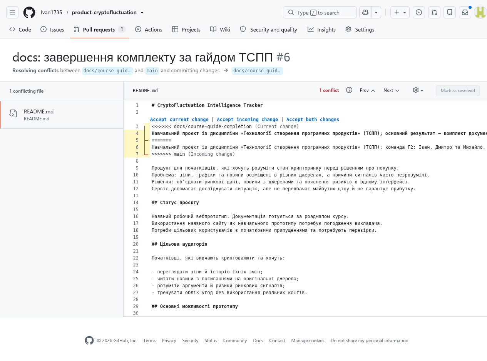

# Git: гілки, людське рев’ю та реальний конфлікт

## Цикл і людське рев’ю

[PR №1](https://github.com/Ivan1735/product-cryptofluctuation/pull/1) містить гілку,
два реальні коментарі Михайла й Дмитра та merge.
[Звіт про рев’ю](../4-quality/review-report.md) зберігає точні посилання й UTC;
коментарі стосуються документації, це не формальні Approve останнього ZIP.
PR №2–5 також інтегровані окремими злиттями.

## Практична №11: контрольована вправа, 01.11.2026

Виконавець — ШІ-асистент за дорученням Івана.
Це реальна **навчальна вправа**, а не вигаданий історичний конфлікт між учасниками.
У [PR №6](https://github.com/Ivan1735/product-cryptofluctuation/pull/6)
та main виконано два корисні уточнення того самого рядка README від спільного предка.

| Крок | Фактична дія / доказ |
|---|---|
| Спільна база | `062b3c11ba2fc669075a81eb1f8d155baa1179ba` |
| Гілка документації | README уточнює, що результат курсу — документація від ідеї до релізу; head до конфлікту `6557e4df18ea32b460c8dbc2cc32e61bf97aefa0` |
| Паралельний main | [0fa5ae5](https://github.com/Ivan1735/product-cryptofluctuation/commit/0fa5ae5a30c4d8e5cf015b30288ac35c38fe8fb5): у тому самому рядку уточнено команду F2 |
| Реальний конфлікт | GitHub показав «This branch has conflicts that must be resolved», README.md; `git merge-tree --write-tree` незалежно дав `CONFLICT (content)` |
| Ручне рішення | У вебредакторі вибрано **Accept both changes**, потім **Mark as resolved → Commit merge**. Обидва уточнення залишились; маркери видалено |
| Merge-коміт рішення | [3a1f01d](https://github.com/Ivan1735/product-cryptofluctuation/commit/3a1f01d40cfd9f3b1d375ca46dadba1a3d266442), батьки `6557e4d…` і `0fa5ae5…` |
| Редакційне очищення | Наступним commit цього PR два збережені речення об’єднано в один рядок без втрати змісту |
| Інтеграція | Фінальний стан merge і CI перевіряється в PR №6 та Actions, не в намальованому графі |

Початкові спроби замінити весь текст редактором не змінили його модель;
тому рішення виконано через видимі кнопки прийняття обох змін, не через обхід забороненого merge.



Додаткові текстові докази: [результат merge-tree](git-conflict-merge-tree.txt),
[фактичний граф після ручного merge](git-conflict-graph.txt).
Це стан до кінцевого злиття PR №6; він не видається за граф фінального релізу.

## Відтворення перевірки

```bash
git clone https://github.com/Ivan1735/product-cryptofluctuation.git
cd product-cryptofluctuation
git log --graph --oneline --all --decorate
git show --format=fuller --no-patch 3a1f01d
git diff 3a1f01d^1 3a1f01d -- README.md
```

Виклик `git merge-tree --write-tree 0fa5ae5 6557e4d` відтворює конфлікт
цих двох незмінних версій (очікуваний ненульовий код), не змінюючи робочу папку.
Сам `git log --graph` показує merge-батьків, але не доводить наявності конфлікту;
для цього збережено початкові версії, скриншот і журнал рішення.
