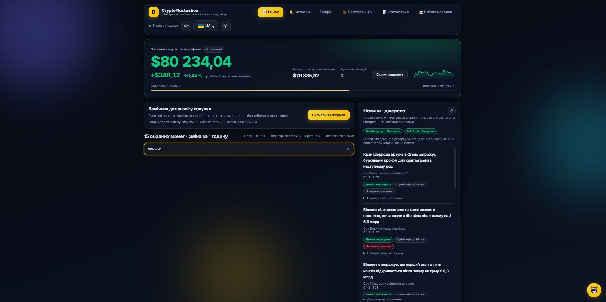

# BUG-001. Відсутнє повідомлення про порожній результат пошуку

## Статус

Відкрито. Виправлення та повторну перевірку не виконано.

## Основні відомості

| Поле | Значення |
|---|---|
| Продукт | CryptoFluctuation Intelligence Tracker |
| Виявив | Іван Носатов |
| Пов’язана вимога | FR-02. Пошук монети |
| Пов’язана перевірка | TC-05 — пошук без збігів |
| Матеріал прототипу | P-03 |
| Серйозність | Незначна (Minor), попередня оцінка |
| Пріоритет | Середній, пропозиція для погодження |
| Версія застосунку | Не зафіксована |
| Дата виявлення | Не зафіксована |

## Середовище

- Локальний вебзастосунок.
- Браузер Google Chrome на комп’ютері.
- Мова інтерфейсу: українська.
- Точні версії браузера та застосунку не зафіксовані.

## Передумови

- Застосунок запущено.
- Відкрито розділ «Ринок».
- За порожнього поля пошуку відображаються картки монет.

## Кроки відтворення

1. Відкрити розділ «Ринок».
2. Натиснути поле «Пошук за назвою або символом».
3. Ввести запит `wwww`.
4. Переглянути область результатів під полем пошуку.

## Очікуваний результат

Картки монет, які не відповідають запиту, не відображаються.

В області результатів показано зрозуміле повідомлення,
наприклад «Нічого не знайдено».

Користувач може змінити або очистити запит.

Відповідний критерій FR-02:
«За відсутності збігів показано повідомлення
про відсутність результатів».

## Фактичний результат

Після введення `wwww` картки монет зникають.

У видимій області під полем пошуку
повідомлення про відсутність результатів не показано.

## Доказ

Скриншот надано користувачем під час ручної перевірки.
Матеріал також описано як P-03 у документації прототипу.

## Вплив на користувача

Порожня область не пояснює, чи немає збігів,
чи виникла помилка завантаження.

Основна робота застосунку не заблокована,
але критерій приймання FR-02 не виконано
в зафіксованому прикладі.

## Відтворюваність

Зафіксовано один приклад із запитом `wwww`.

Повторюваність на інших запитах, мовах і розмірах екрана
ще потрібно перевірити.

## Пропозиція виправлення

Показувати повідомлення про відсутність результатів,
якщо непорожній пошуковий запит не має збігів.

Не підміняти цим повідомленням стан завантаження
або помилку отримання даних.

Після зміни запиту повідомлення має оновлюватися
відповідно до результатів пошуку.

## Критерії повторної перевірки

Після виправлення потрібно перевірити:

1. Запит `wwww` показує повідомлення про відсутність збігів.
2. Запит `BTC` показує відповідну картку
   без повідомлення про відсутність результатів.
3. Очищення запиту повертає повний список.
4. Повідомлення доступне на ширинах 390 і 1440 пікселів.
5. Помилка отримання даних не подається як відсутність збігів.

## Результат повторної перевірки

Не виконано.

Дефект не позначається як виправлений
до фактичної повторної перевірки.

## Пов’язані документи

- [Специфікація вимог](../../1-lifecycle/srs.md)
- [Трасування вимог](../../1-lifecycle/traceability.md)
- [Матеріали прототипу](../../2-architecture/prototype/README.md)
