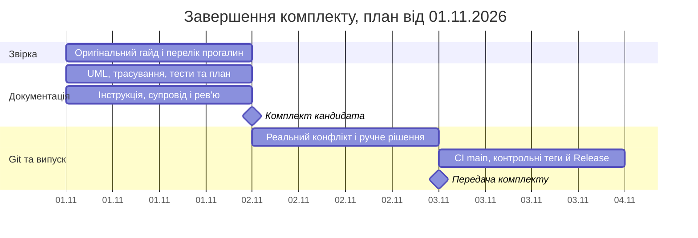

# План проєкту та оцінка трудомісткості

## Обсяг і джерело

Навчальний продукт: CryptoFluctuation Intelligence Tracker.
Базовий результат за гайдом викладача від 13.10.2026 — документація від ідеї до релізу;
новий код не вимагається. Наявний локальний застосунок є додатковою основою прототипу.
Перший MVP: FR-01–FR-08 (ринок, пошук, графік, новини, обмеження даних).
Сигнали, навчальні угоди й повна локалізація — розширення, не умова першого MVP.

## WBS та відносні оцінки

Оцінка виконана 01.11.2026 для аналога такого навчального MVP.
Це модель трудомісткості **не звіт про історичні години чи первісний план команди**.
SP — порівняльна складність з невизначеністю; суми не конвертуються механічно в години.

| WBS | Пакет роботи | Результат | Залежить від | SP | Координація |
|---|---|---|---|---|---|
| 1.1 | Проблема й межі | vision, README | — | 3 | Іван |
| 1.2 | Вимоги та приймання | SRS, MVP, зміни | 1.1 | 5 | Іван; людське рев’ю Дмитра в PR №1 |
| 1.3 | Процес та беклог | process, sprint-plan | 1.2 | 3 | Іван |
| 2.1 | Сценарії й класи | UML use case, class diagram | 1.2 | 5 | Іван + асистент |
| 2.2 | Архітектура та рішення | architecture, modules, 3 ADR | 2.1 | 5 | Іван + асистент |
| 2.3 | Контракти й інтеграція | API, 2 sequence-діаграми | 2.2 | 5 | Іван + асистент |
| 2.4 | Прототип | Головний шлях, помилки й порожні стани | 1.2, 2.3 | 5 | Іван + асистент |
| 3.1 | Дані та валідація | ER, словник, правила полів | 2.3 | 3 | Іван + асистент |
| 3.2 | Git і CI | PR, рев’ю, конфлікт, Actions | 1.3 | 3 | Іван + асистент |
| 4.1 | Тестові специфікації | План, TC/QT, UT й інтеграційні зв’язки | 2.3, 3.1 | 5 | Іван; коментар Михайла в PR №1 |
| 4.2 | Перевірки та дефекти | Звіти, фактичні баги, повторні перевірки | 2.4, 4.1 | 8 | Асистент; окремі ручні дії Івана |
| 4.3 | Статичне рев’ю | Чек-лист, зауваження, рішення | 1.2, 2.2, 2.3 | 3 | Асистент; окремо реальні коментарі команди |
| 5.1 | Супровід і ризики | support, risks, user-guide | 2.4, 4.2 | 3 | Іван + асистент |
| 5.2 | Випуск | CHANGELOG, теги, Release | 3.2, 4.3, 5.1 | 3 | Іван через асистента |
| Разом | Увесь комплект | Оціночний обсяг | — | 62 | Не фактичні трудовитрати |

Ролі в таблиці описують координацію та відомі внески, не нове погодження учасників.
Резерв ризику: приблизно 20% до прогнозованої місткості наступних ітерацій.
Тривалість визначають за доступністю команди, а не множенням SP на години.

## Календар завершення та віхи

Нижче план **поточних залишкових робіт**, а не вигаданий календар минулого семестру.
Більшість документів уже існує; WBS описує повний обсяг, календар — лише завершення.
Роботи можна закінчити раніше; фактичні дати зберігає Git.

## Контроль прогресу та зміни

Оперативна дошка: [sprint backlog](../1-lifecycle/sprint-plan.md) з виконавцями й SP.
Робота переходить у Done після перевірки змісту, посилань і доказів; сам файл не доводить результату.
Зміна MVP проходить опис → оцінку впливу → рішення Івана/команди →
оновлення SRS, MVP, API, тестів, трасування та [журналу](../1-lifecycle/changes.md).
Зміни способу здачі погоджують із викладачем; не видають технічне злиття за оцінку.

## Критерії передачі й ризики

- Базові матеріали гайду доступні через README; додаткові дослідження не вигадуються.
- Є фактичне рев’ю PR, merge та ручне розв’язання конфлікту з Git-доказами.
- Зелений CI на кінцевому main; зовнішня доступність — окрема інформаційна перевірка.
- Відомі результати й обмеження оприлюднені, тег та Release мають точний commit.
- Іван підтверджує правильний акаунт викладача, доступ і здачу на платформі.

Зовнішні джерела, CDN та непідтверджена usability — ризики, не приховані гарантії.
Детальні реакції: [реєстр ризиків](risks.md).
[Випуск](release-plan.md) стосується навчальної документації, не сертифікації торгового сервісу.
