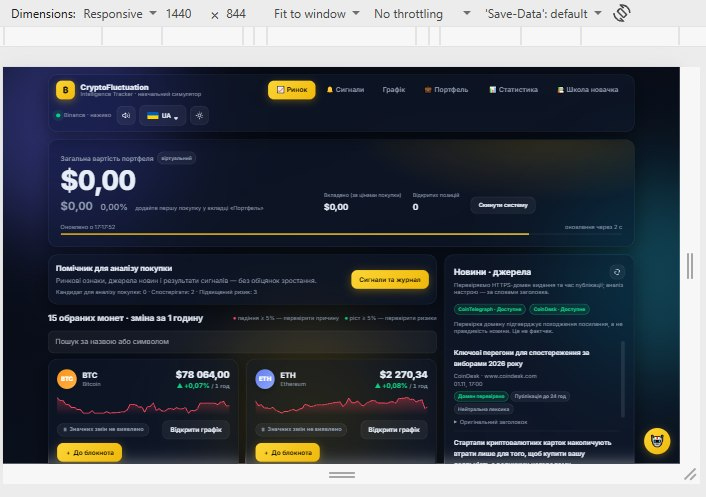
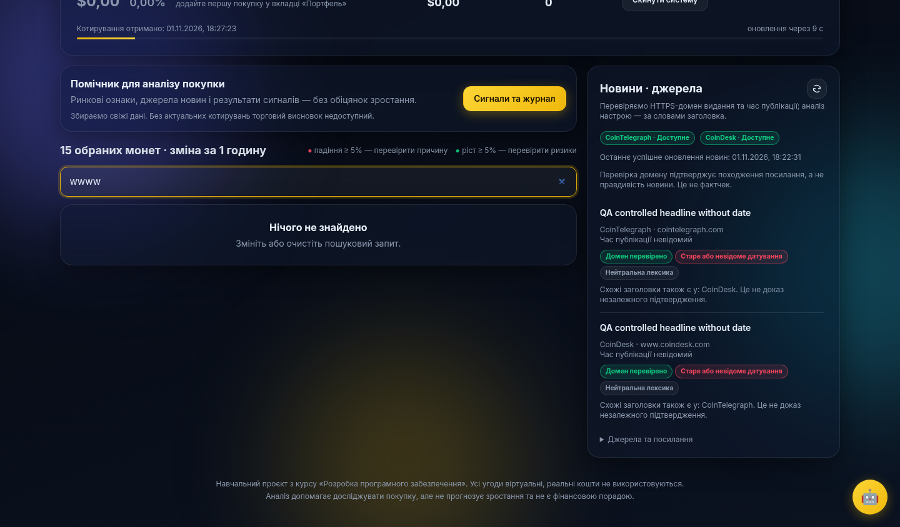
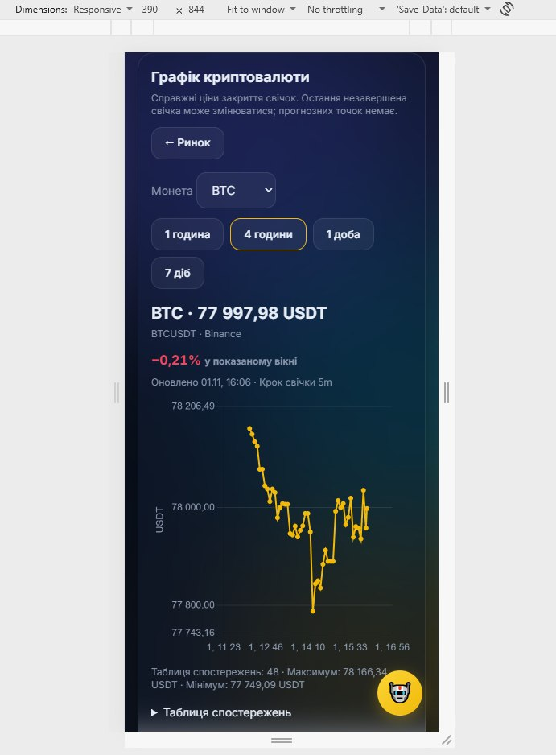
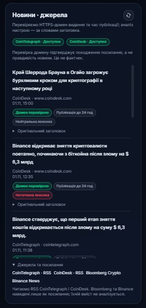
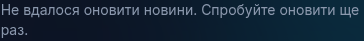
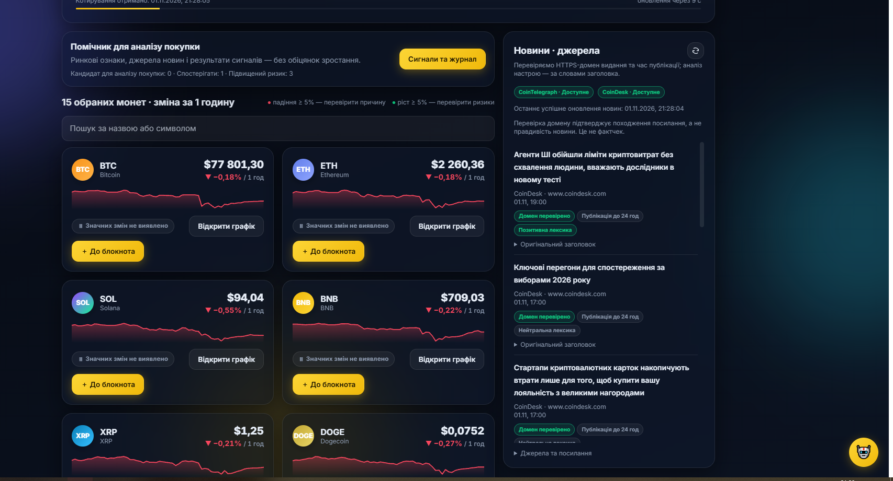

# Інструкція користувача

## 1. Призначення і запуск

CryptoFluctuation Intelligence Tracker — локальний навчальний прототип:
ціни, графіки й новини в одному інтерфейсі. Не виконує реальних торгів,
не зберігає гроші чи приватні ключі та не гарантує прибутку.
USDT — валюта котирування, не банківський долар США.

Описано копію з виправленнями BUG-001–004; попередні скриншоти нижче
ілюструють інтерфейс, а не поточні ціни. Актуальний приклад запуску — наприкінці.
Повну відповідність усім FR/NFR не заявлено.

### Windows, нова папка без старої бази

1. Зупиніть старий сервер: Ctrl+C. Збережіть стару папку й резервну копію БД.
2. Завантажте [архів застосунку](../4-quality/CryptoFluctuation_BUG001-004_fixed.zip),
   розпакуйте в **окрему нову папку** й відкрийте папку з `app.py`.
3. У Провіднику введіть `cmd` в адресний рядок та виконайте:

```bat
python -m venv .venv
.venv\Scripts\python -m pip install -r requirements.txt
.venv\Scripts\python app.py
```

Після запуску відкрийте `http://127.0.0.1:5000`, натисніть Ctrl+F5. Термінал залишайте відкритим.
Для зупинення — Ctrl+C. Не запускайте дві копії на одному порту.

Потрібен встановлений Python; середовище асистента: Python 3.13.15.
Точну версію Python користувача не перевірено. Якщо команда `python` не знайдена,
перевірте встановлення Python і повторно відкрийте термінал.
У ZIP є START_HERE_UA.md і FIX_NOTES_UA.md.

Використовуйте `python app.py`, не `flask run`: потрібні фонові задачі.
Не відкривайте сервер у публічний інтернет. На телефоні 127.0.0.1 означає телефон,
а не ваш ПК. Нова папка створює нову навчальну БД; старі угоди автоматично не переносяться.
Не видаляйте стару БД та не натискайте reset для оновлення.

## 2. Ринок і пошук

Відкрийте вкладку «Ринок». Картка містить символ, назву, ціну та годинну зміну.
Порівнюйте показники з часом отримання та станом джерела, а не лише з кольором.
Дані оновлюються фоновим опитуванням; браузер і мережа можуть затримувати запити.



Введіть `BTC`, `btc`, `Bitcoin` або `bitcoin`: очікується картка Bitcoin.
Очистіть поле кнопкою × — повернеться список. Випадковий запит без збігів
показує «Нічого не знайдено» та підказку змінити або очистити запит.
У старій копії був BUG-001: порожнє місце без пояснення; у наданій копії його виправлено.



## 3. Графік і періоди

На потрібній картці натисніть «Відкрити графік».
Перевірте символ, пару (наприклад BTCUSDT / ETHUSDT), джерело та час оновлення.
У полі «Монета» можна вибрати іншу монету. Кнопка «← Ринок» повертає до списку.

| Період | Крок свічки в поточній копії |
|---|---|
| 1 година | 1 хвилина |
| 4 години | 5 хвилин |
| 1 доба | 30 хвилин |
| 7 діб | 4 години |

Період — уся показана історія, крок — відстань між свічками.
Остання незавершена свічка може змінюватись. Прогнозних точок немає.
«Таблиця спостережень» розкриває значення; відсутні дані не означають нульову ціну.



## 4. Новини та першоджерело

У блоці «Новини · джерела» перегляньте заголовок, видавця, доступну дату та статус.
Перейдіть за публікацією до оригіналу в новій вкладці; вкладка застосунку залишається.
Підтвердження домену перевіряє HTTPS і hostname, **не правдивість змісту**.
За невідомої дати не вважайте публікацію новою лише через її місце у списку.



Якщо джерела відповіли без статей, показано порожній стан.
Якщо оновлення не вдалося, дивіться попередження та час останнього успіху:
раніше збережені статті можуть залишатися, але не видаються за свіжі.



## 5. Обмеження й вузький екран

- «Демонстраційні дані» — не справжні поточні котирування.
- «Застарілі дані» — старий кеш; робочий UI-поріг цієї копії 60 с,
  окремий дослідницький захист 35 с. Це різні правила.
- Недоступність джерела — не нульова ціна й не доказ відсутності ринкового руху.
- Даних недостатньо — обґрунтований аналіз зараз неможливий.
- На вузькому екрані картки розташовані вертикально, кнопка «7 діб» може бути на другому рядку.
  Прокручуйте сторінку; не очікуйте всіх елементів в одному кадрі.
- Сигнали й портфель — навчальні розширення поза першим MVP.
  «Скинути систему» змінює навчальні записи, це не спосіб виправити RSS або мережу.

## 6. FAQ і повідомлення про проблему

| Питання | Дія / відповідь |
|---|---|
| Сторінка не відкривається? | Перевірте термінал, запуск сервера й адресу. Не видаляйте БД |
| Порт 5000 зайнятий? | Зупиніть стару копію сервера; не запускайте другу поверх неї |
| Монета не знайдена? | Очистіть запит, введіть підтримувану назву або символ |
| Графік порожній? | Збережіть повідомлення та параметри, повторіть пізніше; не вигадуйте дані |
| RSS недоступний? | Спробуйте оновлення пізніше. Кеш може бути старим; це зовнішня залежність |
| Чому ціна змінилася? | Котирування живі, остання свічка ще може змінюватися |
| Чи можна використати стару БД? | Лише після зупинки, резервної копії та перевірки сумісності; не копіюйте під час запису |
| Чи це торгова порада? | Ні. Це навчальний аналіз із непідтвердженою прибутковістю |

Для звернення повідомте Івану або створіть GitHub Issue: кроки, очікуване й фактичне,
версію/копію, ОС/браузер, час та скриншот без приватних даних.
Не публікуйте паролі, токени, приватні ключі або робочу БД.

Підтверджений користувачем запуск нового інтерфейсу (не повтор усіх негативних тестів):



Докладніше: [супровід](support.md), [повторна перевірка](../4-quality/qa-known-bugs-retest.md),
[матеріали прототипу](../2-architecture/prototype/README.md).
